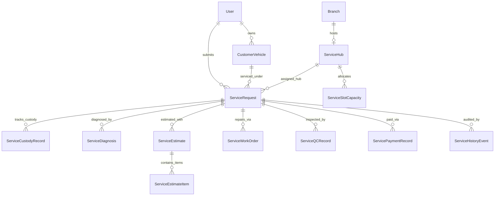
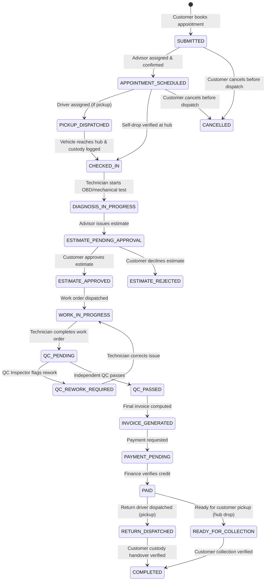

# V MOTIV V2 — Car Service & My Garage Architecture

## 1. Mission & Scope
This document details the complete technical architecture for **Part 1 of 3: Complete Car Service & My Garage** in V MOTIV V2.

Part 1 strictly encompasses:
- **My Garage**: Persistent multi-vehicle ownership repository for customers.
- **Car Service**: 10 animated symptom categories, server-driven dynamic question engine, fixed-package pricing, and diagnostic fee structure.
- **Service Fulfillment**: Doorstep `PICKUP_AND_RETURN` and authorized `SELF_DROP_AT_HUB` with real-time slot capacity management.
- **Hub Operations (`ops.vmotiv.in/service`)**: Service queues, custody check-in, diagnosis, itemized estimates, work orders, independent QC, and return handovers.
- **Service Payments**: Finance-controlled settlement verification (Service Advisors cannot verify payments).
- **Service Tracking**: Real-time customer activity timeline and estimate review/approval modal in the mobile app.

> **Boundary Integrity**: Part 2 (Rental Fleets) and Part 3 (V MOTIV Connect OBD-II Telematics) are strictly separated. Reusable schema and interface stubs (`connectDeviceId`, `connectStatus`) are reserved without implementing unauthorized out-of-scope business logic.

---

## 2. Entity-Relationship Model (Prisma Database)

### Models Summary:
1. `CustomerVehicle`: Customer's saved cars (make, model, year, fuel, transmission, reg #, odo, VIN, preferred flag, soft-archive flag, next service due date/km, reserved connect attributes).
2. `ServiceHub`: Physical automotive centers with geographic coordinates, capacity, operating hours, pickup radius, and fees.
3. `ServiceSlotCapacity`: Atomic slot quotas preventing bay overbooking (`hubId`, `slotDate`, `slotTime`, `maxCapacity`, `bookedCount`).
4. `ServiceIssueTemplate`: Versioned server-configurable issue categories, fixed packages, and dynamic question JSON specifications.
5. `ServiceRequest`: Master service record (`SR-YYYYMMDD-XXXX`), customer symptoms, question answers, fulfillment type, and assignment IDs.
6. `ServiceCustodyRecord`: Physical custody handover sheets (inward check-in & outward check-out), odometer, fuel level, key count, accessories, pre-existing damages, and signatures.
7. `ServiceDiagnosis`: Technical scan & mechanical findings, diagnostic fee, road test flags.
8. `ServiceEstimate`: Versioned itemized quotes (`SENT_TO_CUSTOMER`, `APPROVED`, `DECLINED`, `SUPERSEDED`) with subtotal, GST (18%), discount, and validity.
9. `ServiceEstimateItem`: Itemized parts, labour, consumables, diagnostics, logistics.
10. `ServiceWorkOrder`: Technician assignment, workshop repair instructions, actual hours, completion state.
11. `ServiceQCRecord`: Independent Quality Control verification (`PASS` or `REWORK_REQUIRED`).
12. `ServicePaymentRecord`: Diagnostic fee, advance, or final settlement verified exclusively by `FINANCE` or `SUPER_ADMIN`.
13. `ServiceHistoryEvent`: Append-only audit trail powering the customer mobile tracking timeline.

---

## 3. Service Lifecycle State Machine

---

## 4. API Mount Points

- Customer Endpoints:
  - `GET /api/v2/customer/garage`: List saved vehicles.
  - `GET /api/v2/customer/garage/:id`: Single vehicle details.
  - `POST /api/v2/customer/garage`: Add vehicle to garage.
  - `PATCH /api/v2/customer/garage/:id`: Edit permitted vehicle fields.
  - `DELETE /api/v2/customer/garage/:id`: Soft-archive vehicle (preserves historical invoices & services).
  - `GET /api/v2/service/categories`: Public issue category templates.
  - `GET /api/v2/service/categories/:key`: Category dynamic questions & package data.
  - `GET /api/v2/service/hubs`: Authorized service hubs.
  - `GET /api/v2/service/availability`: Real-time slot capacities.
  - `POST /api/v2/service/requests`: Book service appointment.
  - `GET /api/v2/service/requests`: List customer service requests.
  - `GET /api/v2/service/requests/:id`: Full details, custody sheets, estimate, timeline.
  - `POST /api/v2/service/estimates/:id/respond`: Customer approve or decline estimate.
  - `POST /api/v2/service/requests/:id/cancel`: Cancel pre-dispatch service booking.

- Operations Endpoints (`/api/v2/operations/service/*`):
  - `GET /queue`: Queue dashboard filtered by hub, status, or search.
  - `GET /jobs/:id`: Complete operations service job details.
  - `POST /jobs/:id/schedule`: Confirm appointment and assign service advisor.
  - `POST /jobs/:id/dispatch`: Dispatch pickup driver.
  - `POST /jobs/:id/custody`: Inward physical custody check-in.
  - `POST /jobs/:id/diagnosis`: Submit diagnostic scan & findings.
  - `POST /jobs/:id/estimates`: Issue itemized estimate to customer.
  - `POST /jobs/:id/work-order`: Dispatch repair work order to technician.
  - `PATCH /work-orders/:id`: Technician status update (pause, complete).
  - `POST /jobs/:id/qc`: Independent QC inspection (`PASS` or `REWORK_REQUIRED`).
  - `POST /jobs/:id/return`: Outward custody handover check-out.
  - `POST /jobs/:id/payments`: Initiate service payment record.
  - `POST /payments/:id/verify`: Finance department payment verification.
