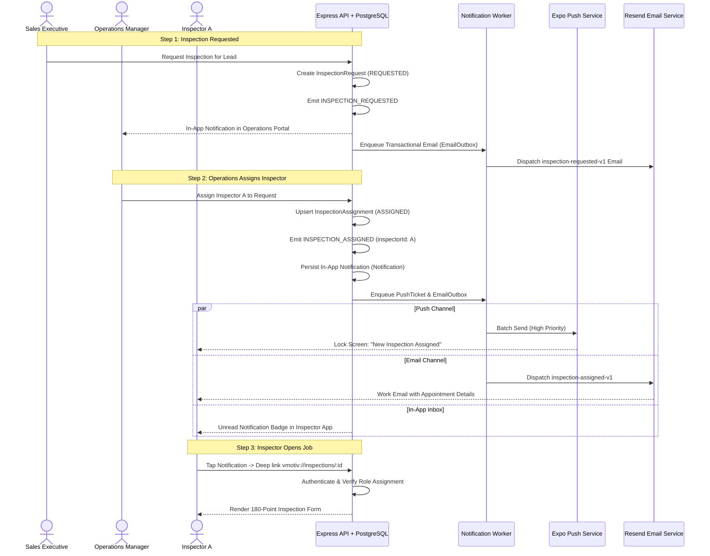

# V MOTIV V2 — Inspector Assignment & Inspection Notification Flow

## 1. Sequence Overview

---

## 2. Reassignment Workflow
If Operations reassigns a job from **Inspector A** to **Inspector B**:
1. `INSPECTION_REASSIGNED` is dispatched to **Inspector A**:
   - In-App: `Inspection Assignment Reassigned: [Vehicle Title]`
   - Push: `Assignment reassigned to another inspector`
   - Email: `Inspection Assignment Update`
2. `INSPECTION_ASSIGNED` is dispatched to **Inspector B**:
   - In-App, Push, and Email with complete job details and assignment schedule.

---

## 3. Rescheduling Workflow
When an appointment date or time window changes:
- `INSPECTION_APPOINTMENT_CHANGED` is emitted.
- Inspector, customer, and sales executive receive coordinated in-app, push, and email confirmations.
