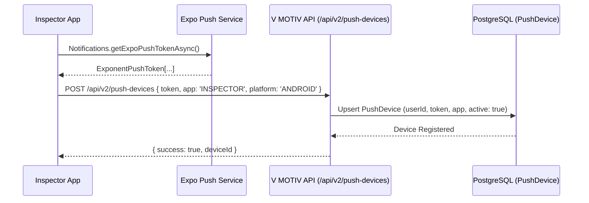

# V MOTIV V2 — Inspector Mobile Push Notification Setup

## 1. Overview
The Inspector Mobile experience is consolidated inside `apps/customer-mobile` with role-based routing. When an authenticated user with active `INSPECTOR` role switches to or launches Inspector mode, device tokens are registered specifically with `app: "INSPECTOR"`.

---

## 2. Firebase Cloud Messaging (FCM v1) Setup on Expo

1. **Service Account Key**:
   Download your Firebase Admin private key from Firebase Console -> Project Settings -> Service Accounts -> Generate New Private Key.

2. **Upload FCM v1 Credentials to EAS**:
   ```bash
   eas credentials -p android
   ```
   Select **Push Notifications -> Set up FCM V1 -> Upload Google Services JSON / Service Account**.

3. **Verify `google-services.json`**:
   Ensure `apps/customer-mobile/google-services.json` is in place with matching package name `in.vmotiv.customer`.

---

## 3. Device Registration Flow



---

## 4. Deep Link & Action Handling

When the inspector taps a push notification on their Android lock screen:
1. Intent opens scheme `vmotiv://inspections/:assignmentId`.
2. App checks Firebase authentication state.
3. If valid inspector role:
   - Sets `activeMode = 'inspector'`.
   - Opens `InspectorScreen`.
   - Directly loads assignment `:assignmentId` and opens the inspection checklist.
4. If unauthenticated or token expired:
   - Presents Google Work Account sign-in.
   - Restores target inspection assignment upon successful authentication.
