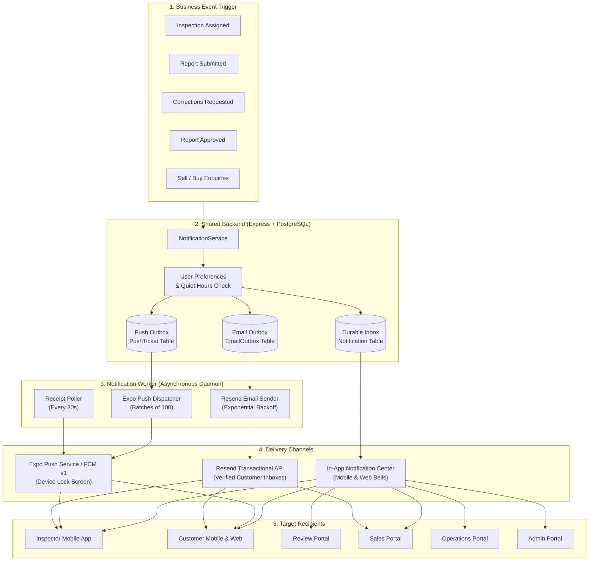

# V MOTIV V2 — Notification & Communication System Architecture

## 1. System Overview

The V MOTIV V2 Notification & Communication Engine is a unified, durable, and asynchronous system providing multi-channel dispatch across the entire business ecosystem:
- **Customer Mobile App** (`apps/customer-mobile`)
- **Inspector Mobile Portal** (`apps/customer-mobile` Inspector Mode)
- **Customer Web Portal** (`apps/customer-web`)
- **Inspection Review Portal** (`apps/inspection-review-portal`)
- **Operations & Dispatch Portal** (`apps/operations-portal`)
- **Sales Executive Portal** (`apps/sales-portal`)
- **Admin & Oversight Portal** (`apps/admin-portal`)

The engine orchestrates three distinct notification channels:
1. **In-App Notifications**: Durable PostgreSQL database inbox (`Notification` model) acting as the single source of truth.
2. **Push Notifications**: Device-level push via Expo Push Service backed by FCM v1 credentials for Android & APNs for iOS.
3. **Transactional Email**: Resend integration featuring verified HTML lockups, outbox queuing, idempotency keys, and webhook delivery status tracking.

---

## 2. Architectural Blueprint

---

## 3. Core Principles & Guarantees

1. **Durable Source of Truth**:
   The PostgreSQL `Notification` record is the primary durable store. Push notifications and transactional emails are delivery mechanisms, never substitutes for saved application state. If a phone is in airplane mode or push permissions are disabled, the user still sees their notifications in their application inbox.

2. **Decoupled Asynchronous Delivery**:
   Network calls to external third-party APIs (Expo and Resend) are never performed inside critical database transaction blocks. Business transactions commit immediately after persisting outbox work (`PushTicket` and `EmailOutbox`), and the background worker dispatches them asynchronously.

3. **Safe Lock Screen Payloads**:
   Push notification payloads delivered to lock screens contain only public, non-sensitive summaries (e.g., `New Inspection Assigned: 2022 Honda City · Tap to open`). Sensitive data (PII, VIN, customer phone numbers, banking coordinates) are strictly restricted behind authenticated app boundaries.

4. **Recipient Privacy & Quiet Hours**:
   User notification preferences (`NotificationPreference`) support quiet hours (default 22:00 to 08:00). Non-urgent notifications respect quiet hours, while urgent operational escalations (`priority: URGENT`) bypass quiet hours.
