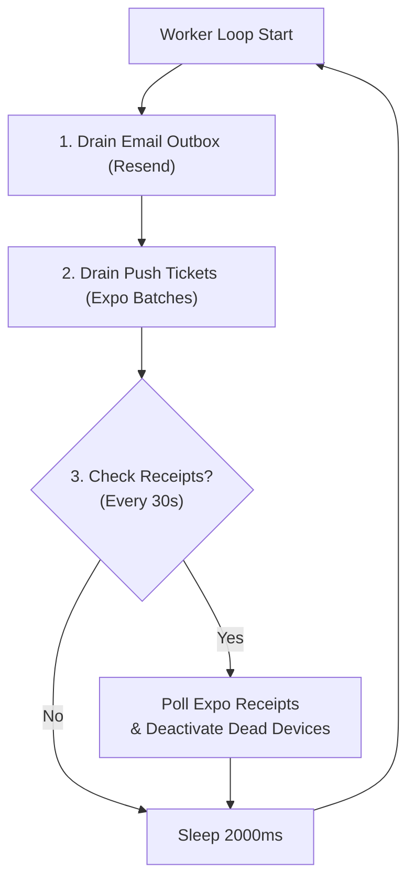

# V MOTIV V2 — Notification Worker Deployment & Operation

## 1. Overview
The Notification Worker (`services/api/src/worker.ts`) is a persistent background daemon responsible for:
1. Draining the Resend transactional email outbox (`EmailOutbox`).
2. Dispatching queued Expo push tickets (`PushTicket`).
3. Polling Expo delivery receipts to confirm delivery and deactivate unregistered tokens.

---

## 2. Running the Worker

### Local Development
```bash
npm run worker -w @vmotiv/api
```

### Production with PM2
```bash
pm2 start services/api/dist/worker.js --name "vmotiv-notification-worker" --restart-delay=3000
```

### Production Systemd Service (`/etc/systemd/system/vmotiv-worker.service`)
```ini
[Unit]
Description=V MOTIV V2 Notification Worker
After=network.target

[Service]
Type=simple
User=vmotiv
WorkingDirectory=/opt/vmotiv/services/api
ExecStart=/usr/bin/node dist/worker.js
Restart=always
RestartSec=5
Environment=NODE_ENV=production

[Install]
WantedBy=multi-user.target
```

---

## 3. Worker Execution Loop


