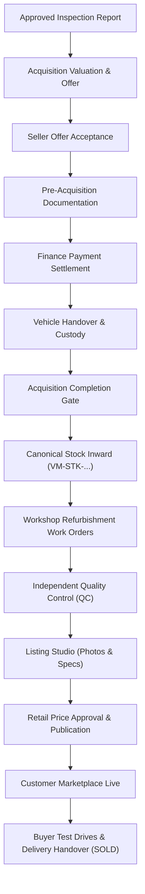

# V MOTIV V2 — Operations Manager Portal Architecture

The Operations Manager Portal (`https://ops.vmotiv.in`, local port `3500`) serves as the central coordination hub connecting the entire vehicle lifecycle after physical inspection:

## 1. Separation of Duties Matrix

| Workflow Stage | Primary Owner | Restricted / Independent Authority |
|---|---|---|
| Inspection Scheduling | Operations Manager | Independent Reviewer approves report |
| Purchase Valuation | Pricing Officer / Operations | Independent Pricing Approver authorizes price |
| Offer Acceptance | Seller (Customer Auth) | Sales/Ops cannot forge customer acceptance |
| Pre-Acquisition Docs | Documentation Officer | Requires all 5 mandatory documents terminal |
| Consideration Payout | Finance Officer | Operations cannot unilaterally verify bank transfers |
| Physical Custody | Custodian / Ops Officer | Requires Finance `PAYMENT_VERIFIED` gate |
| Acquisition Completion | Automated Backend Gate | Validates docs, settlement & custody prerequisites |
| Stock Inward | Inventory / Operations | Generates canonical `VM-STK-XXXXXXXXXX` stock code |
| Refurbishment Orders | Workshop / Inventory | Requester cannot approve their own cost estimates |
| Quality Control | Independent QC Reviewer | Cannot review work orders created by self |
| Listing Preparation | Listing Executive / Studio | Specs and photo curation |
| Retail Publication | Listing Manager / Approver | Commercial readiness audit (QC pass, clear title) |
| Customer Delivery | Operations Officer | Records handover, updates status to `SOLD` |

## 2. Operations Portal Modules

1. **Overview**: Command center KPI cards (Unassigned, Scheduled, In Progress, Completed, Document pending, Settlement ready, Refurbishment jobs, QC pending, Listed, Sold) and live audit event stream.
2. **Inspection Dispatch**: Field inspector scheduling, conflict resolution, date/time picker, workload visibility.
3. **Acquisitions & Valuation**: Seller leads with approved inspection reports, purchase pricing ceiling calculation, independent offer approval status.
4. **Documentation**: Case-by-case KYC, RC, seller authority, hypothecation/NOC, purchase agreement checklists with notes.
5. **Handover & Custody**: Main & spare keys count, actual odometer reading, original documents custody confirmation, condition notes.
6. **Completion & Stock Inward**: Automated completion gate validator unlocking `VM-STK-XXXXXXXXXX` stock establishment.
7. **Inventory Management**: Comprehensive stock registry filterable by 10 statuses, physical hub bay, and VIN.
8. **Refurbishment Workshop**: Repair jobs across mechanical, body/paint, interior, electrical; cost approval submission and independent decisions.
9. **Quality Control**: Independent QC verdict (`PASS`, `REWORK_REQUIRED`, `FAIL`) with rework feedback loops.
10. **Listing Studio**: Photo curation, title, exterior color, features, condition and inspection summary disclosures.
11. **Retail Publication**: Commercial readiness gate audit, retail asking price approval, 1-click publishing to customer marketplace.
12. **Buyer Test Drives & Delivery**: Test drive appointment confirmation and customer delivery handover marking vehicle as `SOLD`.
13. **Team & Workload**: Inspector roster with active job loads and branch coverage.
