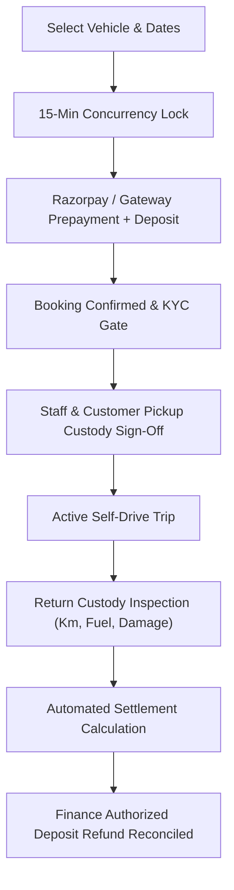

# V MOTIV V2 — Advance Car Rental Platform Business Model

## 1. Executive Summary & Operating Scope

The **V MOTIV Advance Car Rental Platform** (Part 2 of the V MOTIV V2 expansion) operates as a **company-managed, self-drive rental marketplace**. Unlike peer-to-peer (P2P) platforms or unvetted aggregator listings, V MOTIV manages an authorized, high-standard fleet of verified vehicles.

### Non-Negotiable Boundaries:
1. **Strictly Company-Controlled Fleet Only**: Vehicles are directly owned, leased, or contracted under formal fleet agreements by V MOTIV.
2. **No P2P Hosting or Customer Vehicle Mixing**: Private vehicles saved in a customer's *My Garage* or resale acquisition inventory are never exposed or bookable as rental cars.
3. **Yellow-Plate Commercial Compliance**: All rental cars hold valid commercial transport registrations (Rent-a-Cab scheme permits) as mandated by the Indian Motor Vehicles Act.
4. **Transparent, Zero-Hidden-Fee Pricing**: Pricing includes standard mileage allowance, statutory 18% GST (9% CGST + 9% SGST), and a 100% refundable security deposit with zero undocumented deductions.

---

## 2. Rental Fleet Segmentation & Offerings

V MOTIV's rental fleet is categorized into well-defined segments tailored to urban self-drive needs:

| Segment | Representative Models | Daily Base Rate | Security Deposit | Daily Free Km Allowance | Extra Km Rate |
| :--- | :--- | :--- | :--- | :--- | :--- |
| **Compact Hatchback** | Tata Tiago, Maruti Swift | ₹1,800 / day | ₹3,000 (Refundable) | 250 km / day | ₹9 / km |
| **Premium Compact SUV** | Hyundai Creta, Kia Seltos | ₹3,000 / day | ₹5,000 (Refundable) | 250 km / day | ₹12 / km |
| **Executive Sedan** | Honda City, Hyundai Verna | ₹3,200 / day | ₹5,000 (Refundable) | 250 km / day | ₹12 / km |
| **Spacious 7-Seater MPV** | Toyota Innova Crysta, Maruti Ertiga | ₹4,200 / day | ₹7,000 (Refundable) | 300 km / day | ₹15 / km |
| **Premium EV** | Tata Nexon EV, BYD Atto 3 | ₹3,500 / day | ₹6,000 (Refundable) | 200 km / day | ₹10 / km |

---

## 3. Booking Horizons & Reservation Dynamics

- **Advance Booking Horizon**: Customers may book up to **90 days in advance**.
- **Minimum Notice Requirement**: Bookings must be created at least **2 hours prior** to the scheduled pickup window to permit vehicle dispatch sanitization and physical pre-flight inspection.
- **Minimum Rental Duration**: **8 continuous hours**.
- **Maximum Rental Duration**: **30 continuous days** under standard retail checkout. Longer durations require operational fleet contract approval.
- **Turnaround Buffer**: Every return automatically triggers a **120-minute operational block** (`cleaningBufferMinutes`) preventing back-to-back overlap and ensuring vehicles are thoroughly washed, inspected, and refueled before next release.

---

## 4. Financial & Custody Lifecycle

1. **Reservation & Hold**: Customer selects interval; system acquires an exclusive 15-minute hold preventing duplicate reservations.
2. **Payment Execution**: Customer pays fare + 18% GST + refundable deposit via authenticated gateway.
3. **Driver KYC Gate**: Driver submits valid Indian Driving License (min 21 yrs age, min 1 yr experience). Key handover is strictly blocked until KYC status is `VERIFIED`.
4. **Physical Handover**: Hub staff documents odometer, fuel level, existing exterior photos, and captures customer digital signature.
5. **Return & Settlement**: Hub staff records return odometer, return fuel percentage, and inspects for damage. Disputed damages are never auto-deducted; settlement releases refundable deposit within statutory banking windows.
