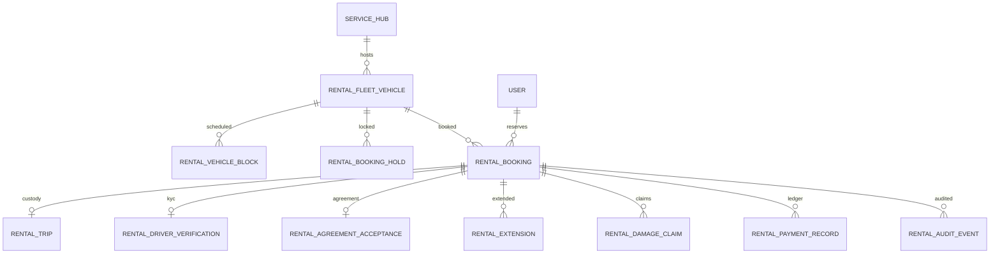

# V MOTIV V2 — Rental Fleet Schema & Data Architecture

## 1. Domain Model Overview

The advance car rental domain is encapsulated in PostgreSQL via Prisma with explicit relationships to canonical customer accounts (`User`), service hubs (`ServiceHub`), and financial ledgers (`RentalPaymentRecord`).

---

## 2. Model Definitions

### `RentalFleetVehicle`
Stores the canonical identity and compliance configuration of each rental fleet asset.
- `id` (UUID): Primary key.
- `fleetNumber` (String, Unique): e.g. `VMF-001`.
- `registrationNumber` (String, Unique): Commercial registration.
- `vin` (String, Unique): 17-character chassis number.
- `make`, `model`, `variant`, `year`: Vehicle catalog details.
- `transmission` (`MANUAL` | `AUTOMATIC`).
- `fuelType` (`PETROL` | `DIESEL` | `EV` | `HYBRID` | `CNG`).
- `seats` (Int, Default 5).
- `odometerKm` (Int): Current recorded odometer.
- `fuelLevelPercent` (Int, Default 100): Current fuel tank percentage.
- `hubId` (UUID): Current home hub (`ServiceHub`).
- `images` (Json): Verified high-resolution photos.
- `status` (`AVAILABLE` | `ON_TRIP` | `MAINTENANCE` | `CLEANING` | `RESERVED` | `RETIRED`).
- `commercialPermitNumber`, `commercialPermitExpiry` (DateTime).
- `insurancePolicyNumber`, `insuranceExpiry` (DateTime).
- `fitnessCertExpiry` (DateTime).
- `isEligibleForRental` (Boolean).
- `baseDailyRatePaise`, `baseHourlyRatePaise` (BigInt).
- `securityDepositPaise` (BigInt).
- `includedKmPerDay` (Int, Default 250).
- `extraKmRatePaise` (BigInt, Default 1200 paise = ₹12/km).
- `cleaningBufferMinutes` (Int, Default 120 mins).

### `RentalVehicleBlock`
Records scheduled maintenance, turnaround cleaning buffers, or regulatory off-road periods.
- `id` (UUID): Primary key.
- `vehicleId` (UUID): References `RentalFleetVehicle`.
- `reason` (`MAINTENANCE` | `CLEANING` | `OPERATIONAL_RESTRICTION` | `ACCIDENT_REPAIR` | `BUFFER`).
- `startTime`, `endTime` (DateTime): Half-open interval.
- `notes` (String?).

### `RentalBookingHold`
Exclusive 15-minute checkout lock preventing race conditions and double-bookings.
- `id` (UUID): Primary key.
- `holdCode` (String, Unique): e.g. `HLD-M8Z91-4A`.
- `vehicleId` (UUID): References `RentalFleetVehicle`.
- `customerId` (UUID): References `User`.
- `hubId` (UUID): References `ServiceHub`.
- `startTime`, `endTime` (DateTime): Booking interval.
- `expiresAt` (DateTime): Exactly `createdAt + 15 minutes`.
- `status` (`ACTIVE` | `CONVERTED` | `EXPIRED` | `RELEASED`).
- `quoteSnapshot` (Json): Immutable pricing breakdown.
- `estimatedTotalPaise` (BigInt).

### `RentalBooking`
Canonical booking record tracking status transitions from payment through final return settlement.
- `id` (UUID): Primary key.
- `bookingNumber` (String, Unique): e.g. `VMR-2026-0001`.
- `holdId` (UUID, Unique?): Originating hold.
- `customerId` (UUID): References `User`.
- `vehicleId` (UUID): References `RentalFleetVehicle`.
- `pickupHubId`, `returnHubId` (UUID): References `ServiceHub`.
- `startTime`, `endTime` (DateTime): Scheduled interval.
- `status` (`PENDING_PAYMENT` | `CONFIRMED` | `VEHICLE_COLLECTED` | `TRIP_ACTIVE` | `RETURN_INSPECTED` | `SETTLED` | `CANCELLED`).
- `kycStatus` (`PENDING_REVIEW` | `VERIFIED` | `REJECTED`).
- `pricingSnapshot` (Json): Complete itemized ledger.
- `baseFarePaise`, `taxPaise`, `securityDepositPaise`, `totalPayablePaise` (BigInt).
- `includedKm` (Int), `extraKmRatePaise` (BigInt).
- `cancellationReason`, `cancelledAt` (DateTime?).

### `RentalDriverVerification`
Sensitive driver KYC record with strict access controls.
- `bookingId` (UUID, Unique): References `RentalBooking`.
- `customerId` (UUID): References `User`.
- `licenseNumber` (String): Driving License number.
- `licenseExpiry` (DateTime).
- `licenseCategory` (String, e.g. "LMV").
- `dateOfBirth` (DateTime): Verified age >= 21 years.
- `drivingExperienceYears` (Int): Min 1 year.
- `licenseFrontUrl`, `licenseBackUrl` (String): Private storage references.
- `status` (`PENDING_REVIEW` | `VERIFIED` | `REJECTED`).
- `rejectionReason` (String?).
- `verifiedById` (UUID?), `verifiedAt` (DateTime?).

### `RentalTrip`
Pickup and return physical custody evidence.
- `pickupTime` (DateTime), `pickupOdometerKm` (Int), `pickupFuelPercent` (Int).
- `pickupPhotos` (Json), `pickupNotes` (String?), `pickupCustomerSigned` (Boolean).
- `returnTime` (DateTime), `returnOdometerKm` (Int), `returnFuelPercent` (Int).
- `returnPhotos` (Json), `returnNotes` (String?), `returnCustomerSigned` (Boolean).
- `excessKm` (Int), `excessKmChargePaise` (BigInt).
- `fuelRefillChargePaise` (BigInt), `lateReturnChargePaise` (BigInt), `damageChargePaise` (BigInt).
- `totalAdditionalChargesPaise` (BigInt), `depositRefundPaise` (BigInt).
- `isSettled` (Boolean), `settledAt` (DateTime?).

### `RentalDamageClaim`
Damage claim documentation with customer dispute tracking.
- `bookingId` (UUID): References `RentalBooking`.
- `description` (String), `estimatedRepairCostPaise` (BigInt), `photos` (Json).
- `reportedByStaffId` (UUID).
- `isCustomerDisputed` (Boolean, Default false): When true, claim is flagged for Finance review and NEVER auto-deducted.
- `customerDisputeNotes` (String?).
- `resolvedCostPaise` (BigInt?), `resolutionNotes` (String?).
- `resolvedByFinanceId` (UUID?).
