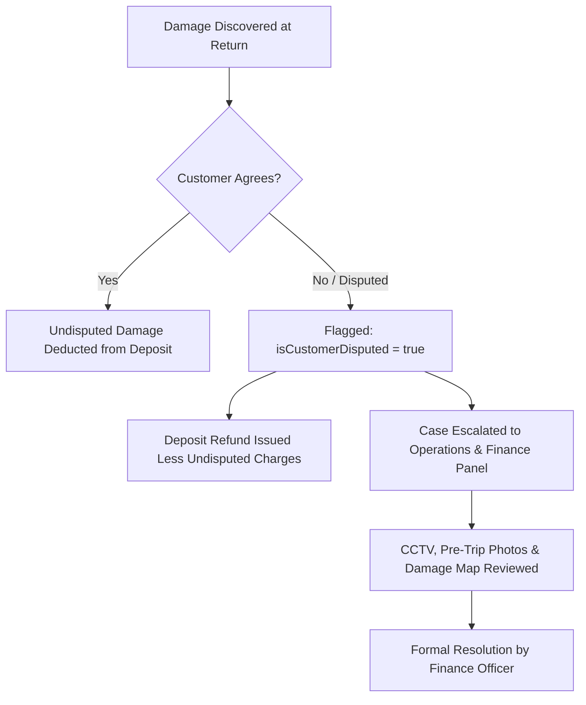

# V MOTIV V2 — Rental Refunds, Settlement & Dispute Resolution

## 1. Customer Cancellation Policy

Cancellations are calculated server-side based on the notice given prior to the scheduled pickup time:

| Notice Prior to Scheduled Pickup | Rental Fare Refund | Security Deposit Refund |
| :--- | :--- | :--- |
| **> 24 Hours in Advance** | **100% Full Refund** | **100% Full Refund** |
| **6 to 24 Hours in Advance** | **50% Fare Refund** (50% Cancellation Fee) | **100% Full Refund** |
| **< 6 Hours in Advance / No-Show** | **0% Fare Refund** (1 Day Minimum Retained) | **100% Full Refund** |

*Note: The security deposit is ALWAYS 100% refunded in all pre-pickup cancellation scenarios.*

---

## 2. Damage Dispute Protection & Non-Auto-Deduction Guarantee

A critical fairness commitment of the V MOTIV platform is that **unverified or disputed damage is NEVER auto-deducted from a customer's security deposit**.

1. **Dispute Recording**: If the customer objects to a damage claim, staff marks `isDisputed: true` and records the customer's explanation (`customerDisputeNotes`).
2. **Escrow & Refund Release**: The customer's undisputed refundable deposit is **not held hostage**; it is released while the disputed claim is independently reviewed.
3. **Finance Oversight**: Only authorized Finance officers (`requireRentalRole(['FINANCE', 'SUPER_ADMIN'])`) can adjudicate damage liability or authorize bank claims.
