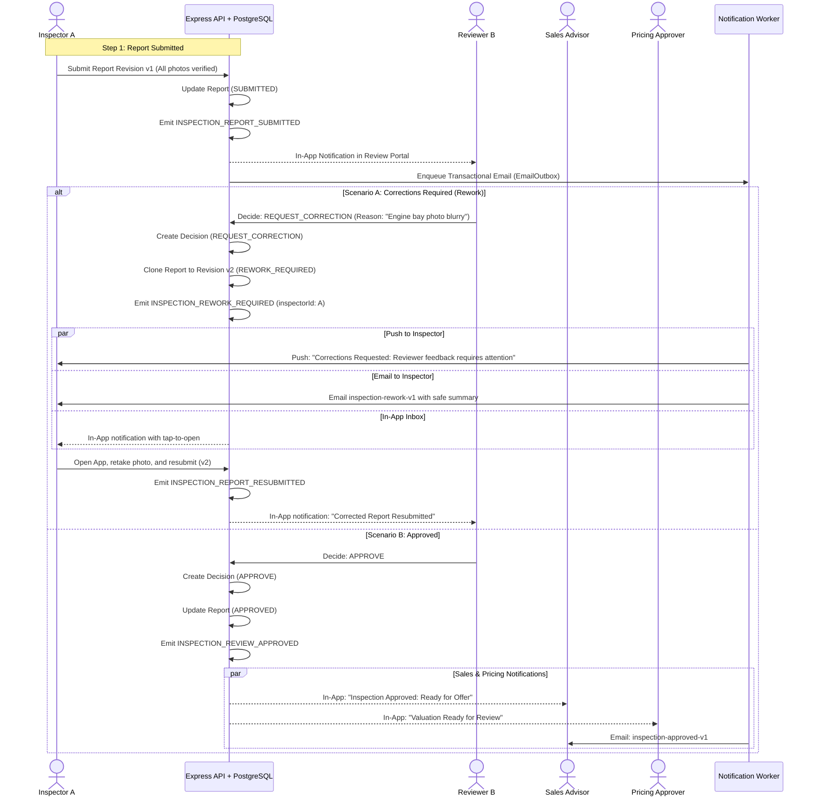

# V MOTIV V2 — Inspection Review & Quality Gate Notification Flow

## 1. Sequence Overview

---

## 2. Review Portal Queue Controls

The Review Queue (`/inspection-review/queue`) features:
1. **Default Ordering**: Newest submitted first (`submitted_desc`) to ensure rapid turnaround on incoming reports.
2. **Stable Pagination**: Secondary sort on `id DESC`.
3. **Status Filtering**: `ALL`, `SUBMITTED`, `UNDER_REVIEW`.
4. **Server-Side Text Search**: Search across vehicle make, model, reference code, and seller name.
5. **Real-Time Notification Bell**: Unread indicator and quick dropdown displaying recent review events.
