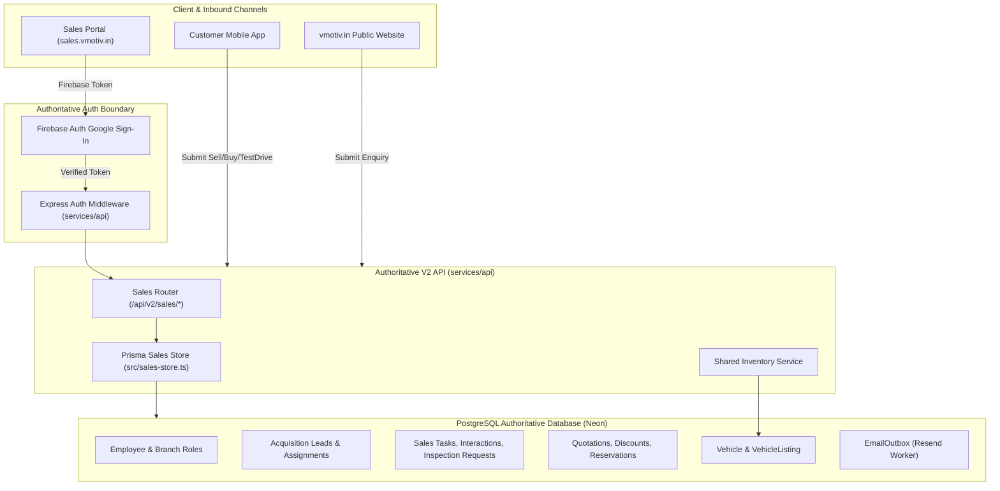
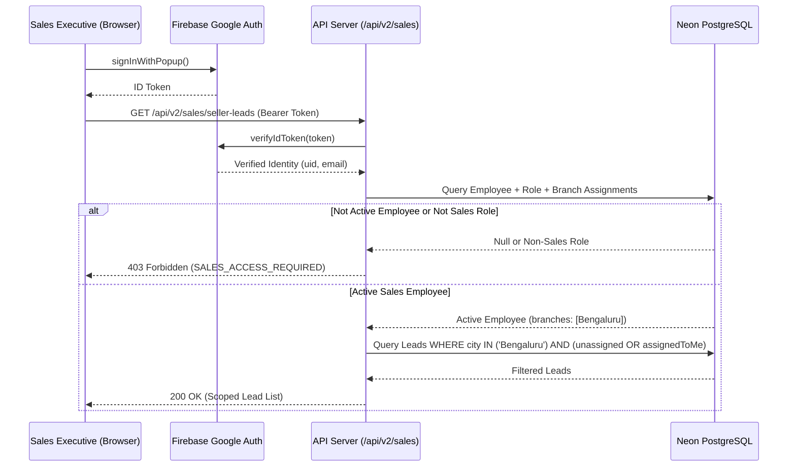

# V MOTIV V2 — Sales Executive Portal Architecture

## Status
`COMPLETED` — The Sales Executive Portal (`sales.vmotiv.in` / `apps/sales-portal`) is fully implemented and operational on top of the existing authoritative V2 Express API, PostgreSQL (Neon DB), Firebase Auth, Admin-managed employee records, and shared inventory catalog.

---

## 1. System Topology & Core Tenets



### Core Tenets
1. **Single Authoritative Backend**: No separate backend or secondary database. All workflows run against `services/api` and Neon PostgreSQL.
2. **Server-Side Enforcement**: Role-based access control (RBAC) and branch/geographic scoping are derived strictly from database employee records (`Employee`, `RoleAssignment`, `BranchAssignment`), never from client tokens or local storage.
3. **Multi-Branch Isolation**: Sales executives see only unclaimed leads or explicitly assigned leads within their assigned branch city scope. Cross-branch probing returns `404 Not Found` to prevent ID enumeration.
4. **Concurrency Safety**: Vehicle stock reservations execute inside transactional advisory checks preventing double-booking of unique vehicles.
5. **Separation of Concerns**: Non-financial client views in the sales portal do not expose internal vehicle acquisition cost, margin thresholds, or administrator configurations.

---

## 2. Directory Structure

```
vmotiv-v2/
├── apps/
│   ├── sales-portal/                  # React + Vite + TypeScript frontend (Port 3300)
│   │   ├── public/
│   │   │   ├── brand/                 # Official SVG and vector brand assets
│   │   │   ├── favicon.ico
│   │   │   └── favicon.png
│   │   ├── src/
│   │   │   ├── api.ts                 # Authoritative typed client for /api/v2/sales/*
│   │   │   ├── firebase.ts            # Client-side Google auth integration
│   │   │   ├── icons.tsx              # Clean SVG icons (no emoji anti-pattern)
│   │   │   ├── main.tsx               # Reactive application shell, navigation & modals
│   │   │   └── styles.css             # Flat Design System (Density 8/10, Fira Sans + Fira Code)
│   │   ├── package.json
│   │   ├── vite.config.ts
│   │   └── vercel.json                # COOP unsafe-none + API reverse proxy rewrites
├── services/
│   └── api/
│       ├── prisma/
│       │   ├── schema.prisma          # Authoritative data schema
│       │   └── migrations/
│       │       ├── 20261024180000_sales_crm_foundation/
│       │       └── 20261024210000_sales_quotations_and_reservations/
│       ├── src/
│       │   ├── app.ts                 # Express mounting for /api/v2/sales
│       │   ├── sales-router.ts        # Zod-validated REST endpoints
│       │   └── sales-store.ts         # Authoritative business logic & transactions
│       └── test/
│           ├── sales-api.test.ts      # End-to-end API integration tests (Vitest)
│           └── sales-database.test.ts # PostgreSQL branch isolation tests
└── docs/                              # Comprehensive documentation suite
```

---

## 3. Security & Branch Isolation Model



- **Global Scope vs Branch Scope**:
  - `SUPER_ADMIN`, `ADMIN`, `OPERATIONS_MANAGER` have `globalScope: true` and can view all branch queues.
  - `SALES_EXECUTIVE` has `globalScope: false` and is constrained strictly to `actor.branches.map(b => b.city)`.
- **Enumeration Protection**: Probing a lead or appointment belonging to an unassigned branch produces `404 SELLER_LEAD_NOT_FOUND` rather than `403 FORBIDDEN` to prevent resource enumeration.
- **Cross-Origin Opener Policy**: `apps/sales-portal/vercel.json` and Express helmet configure `Cross-Origin-Opener-Policy: unsafe-none` to ensure seamless Google OAuth popup completion.
