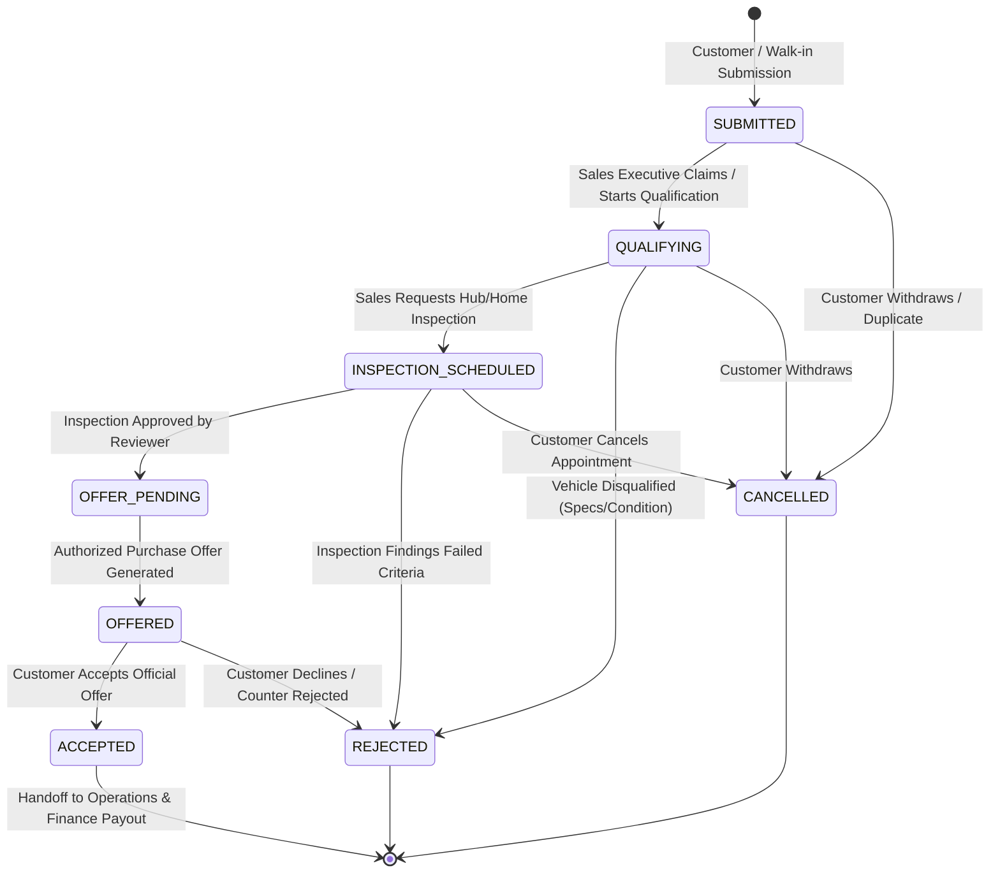
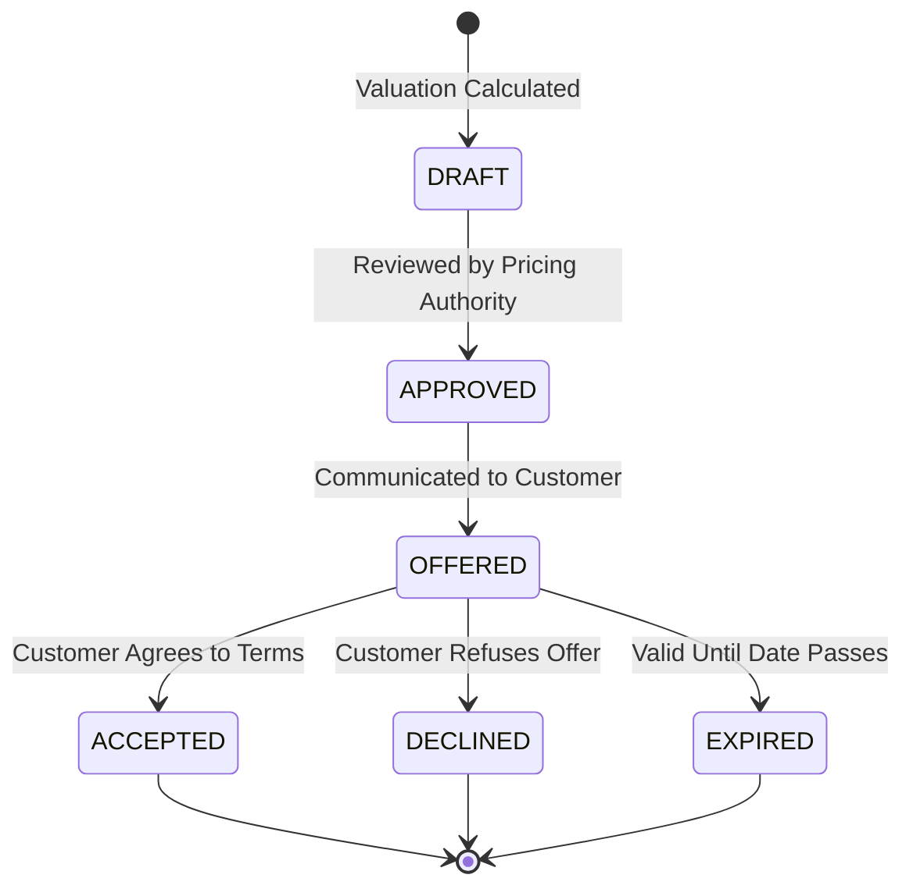
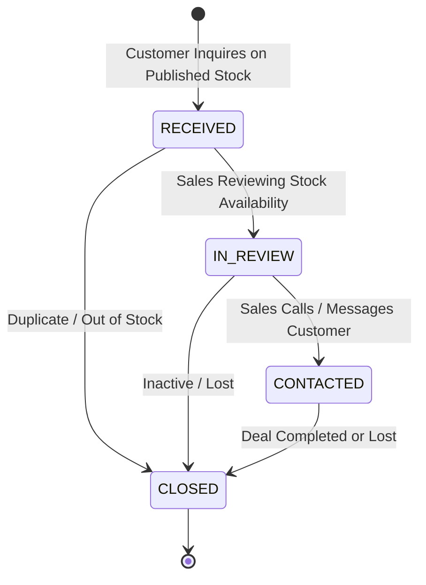
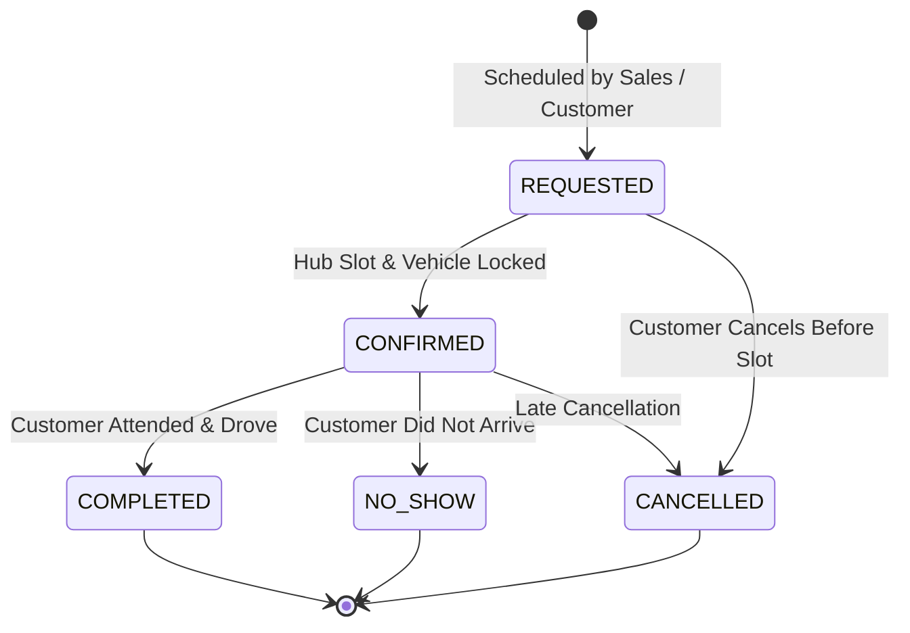
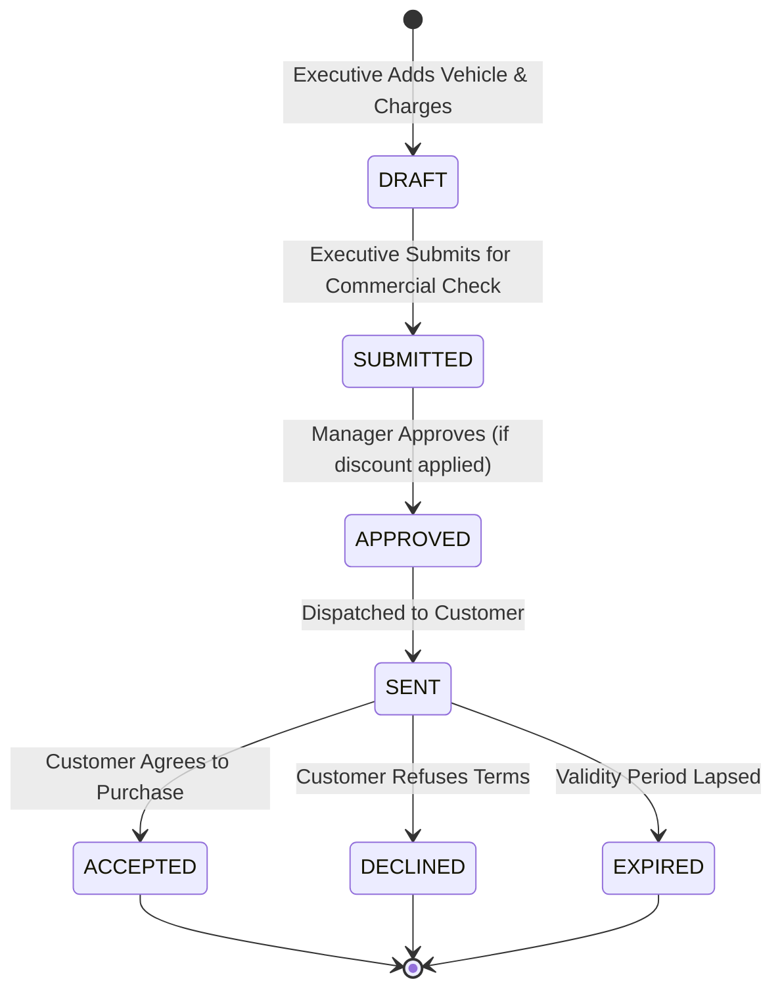
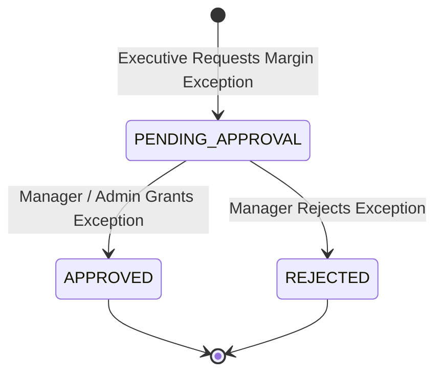
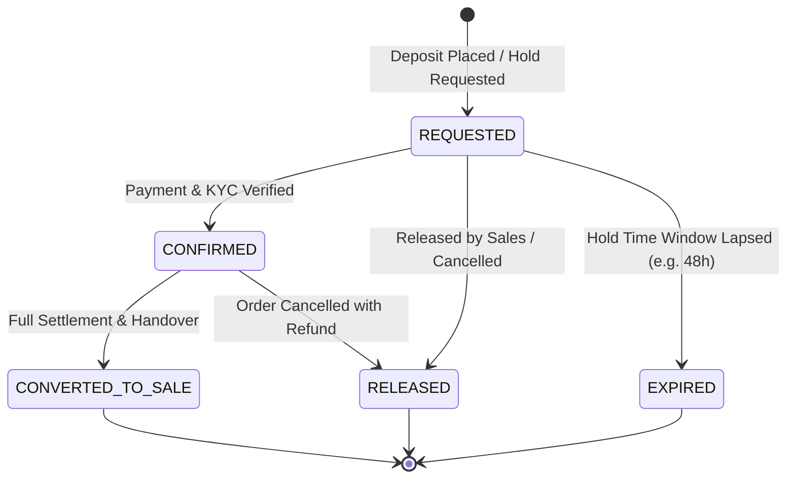
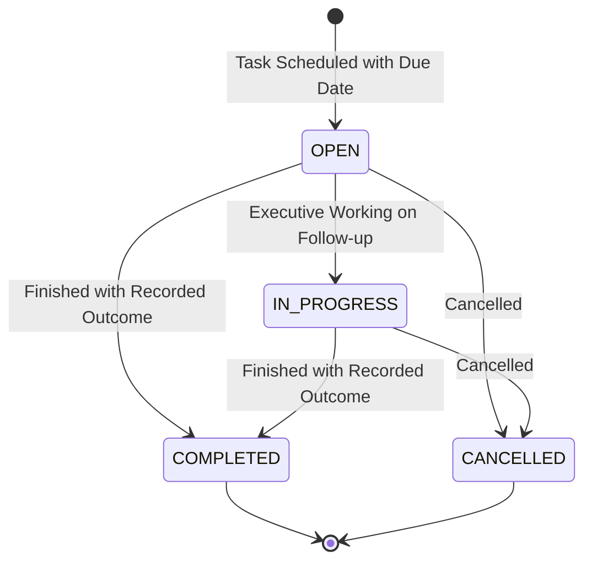

# V MOTIV V2 — Sales Executive Portal State Machines

## 1. Seller Lead State Machine (Acquisition Lead)

### Transition Rules:
- **`SUBMITTED` ➔ `QUALIFYING`**: Triggered automatically on claim or explicit status progression.
- **`QUALIFYING` ➔ `INSPECTION_SCHEDULED`**: Atomically enforced when an `InspectionRequest` is created.
- **`INSPECTION_SCHEDULED` ➔ `OFFER_PENDING`**: Requires independent approved evaluation report.
- **`OFFER_PENDING` ➔ `OFFERED`**: Requires signed acquisition offer record with validity date.
- **`OFFERED` ➔ `ACCEPTED` / `REJECTED`**: Recorded via `POST /offers/:offerId/decision` with mandatory reason if declined.

---

## 2. Acquisition Offer State Machine

---

## 3. Buyer Purchase Enquiry State Machine

---

## 4. Test Drive Appointment State Machine

---

## 5. Retail Quotation State Machine

---

## 6. Discount Exception State Machine

---

## 7. Vehicle Reservation State Machine (Concurrency-Safe)

### Concurrency Rules:
- A vehicle listing may have at most **one** active reservation in status `REQUESTED` or `CONFIRMED`.
- Attempting to place an overlapping reservation on the same listing triggers a `409 CONFLICT: LISTING_ALREADY_RESERVED` error.

---

## 8. CRM Sales Task State Machine

### Validation Rules:
- Completing a task strictly requires a non-empty `actualOutcome` string describing the customer response or action taken.
