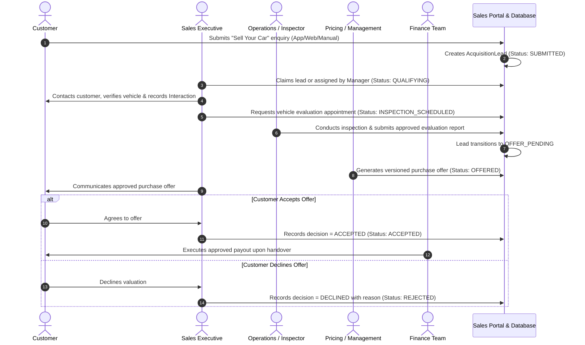
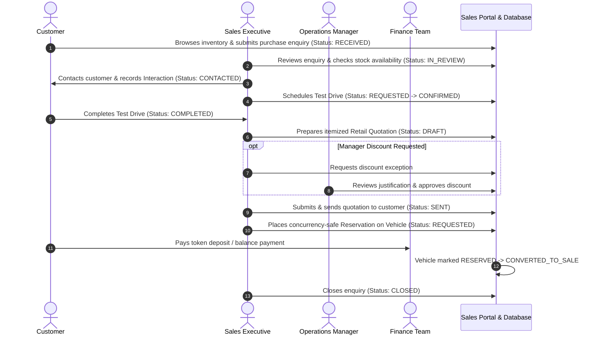

# V MOTIV V2 — Sales Executive Portal Workflows

## Workflow A — V MOTIV Buys a Car from a Customer

### Detailed Steps:
1. **Enquiry Creation**: Customer submits details (Make, Model, Year, Fuel, Odo, Expected Price). System assigns a unique reference code (`VM-ACQ-XXXX`).
2. **First Response & Claiming**: The sales executive in the relevant branch claims the lead. This atomic operation sets `assignments: { create: { employeeId, assignedAt } }` and transitions status to `QUALIFYING`.
3. **Qualification & Interactions**: The executive calls or messages the seller. Details are recorded in `LeadInteraction`. If vehicle criteria are met, qualification is confirmed.
4. **Inspection Request**: Executive specifies location (Hub/Home), date, and slot. Operations assigns an inspector.
5. **Findings Approval**: The inspector verifies physical condition, chassis/engine numbers, and service history. An independent reviewer approves the valuation findings.
6. **Offer Generation & Decision**: An authoritative acquisition offer is published. When communicated, the seller either accepts (triggering procurement payout coordination) or declines.

---

## Workflow B — V MOTIV Sells a Car to a Customer

### Detailed Steps:
1. **Stock Enquiry**: Customer browses published listings and expresses interest. A `PurchaseEnquiry` record is linked directly to the `VehicleListing`.
2. **Review & Contact**: Sales executive verifies inventory availability in the branch and contacts the buyer.
3. **Test Drive Appointment**: If the customer desires a trial, a `TestDriveRequest` is scheduled with designated time slot. The executive records completion notes.
4. **Quotation Generation**: Sales creates a versioned `BuyerQuotation` with itemized charges (Base vehicle price, RTO, Insurance, Fastag, Warranty, Accessories).
5. **Discount Approval**: If the buyer requests pricing adjustments exceeding executive limits, a `DiscountRequest` is routed to the Operations Manager for formal approval.
6. **Vehicle Reservation**: To protect customer commitment, an atomic reservation is placed on the vehicle with a 48-hour hold window. Overlapping reservations on the same vehicle listing are prevented by database constraints.
7. **Settlement & Delivery**: Upon payment verification by Finance, the vehicle is prepared for customer delivery, and the lead is marked `CLOSED`.
