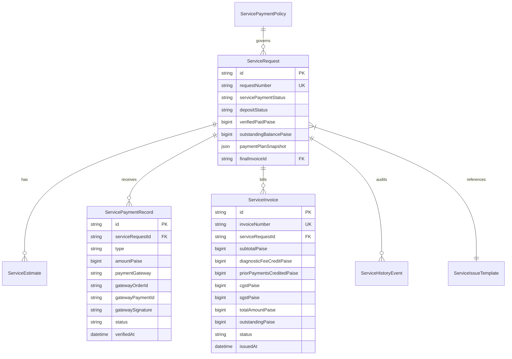
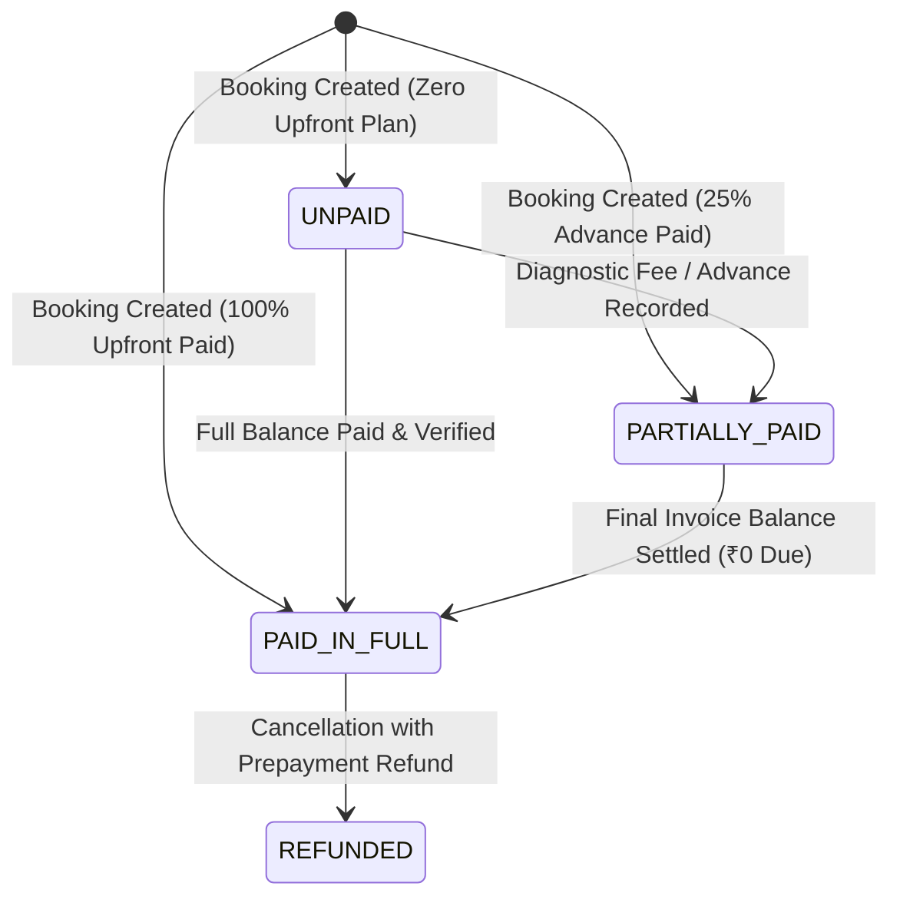

# V MOTIV V2 — Service Booking Payment Architecture

## 1. Overview & Architectural Principles

The V MOTIV V2 Service Booking Payment System provides an end-to-end, multi-application financial lifecycle for automotive workshop servicing. Built on a shared PostgreSQL (Neon DB) backend and Node.js/Express API, it seamlessly connects four distinct applications:
1. **Customer Mobile App (React Native/Expo)**: Enables customers to pick vehicles, select fixed maintenance packages or diagnostic bookings, choose flexible upfront payment plans (Zero Upfront, 25% Advance, 100% Full Payment), review itemized estimates, approve estimate versions, and pay outstanding balances securely.
2. **Customer Web Portal (React/Vite)**: Mirrors package selections and booking payment plan choices for web users.
3. **Operations Manager Portal (React/Vite)**: Provides service advisors and hub managers with real-time visibility into verified payments, balance dues, estimate approvals, final tax invoice generation (18% GST), dynamic package pricing management, and authoritative vehicle release gates.
4. **Finance Portal (React/Vite)**: Centralized commercial document ledger, tax invoice audit trails, and bank reconciliation.

### Strict Non-Negotiable Tenets
- **Paise Precision**: All monetary values are strictly stored as `BigInt` paise in the database to prevent floating-point rounding errors.
- **Single Source of Truth**: Shared PostgreSQL database using Prisma ORM. No shadow or duplicate payment tables.
- **HMAC SHA-256 Verification**: Server-side signature checks on all gateway callbacks with idempotency keys. No client-simulated payment statuses.
- **Authoritative Release Gate**: Vehicle handover is mechanically blocked by backend release readiness checks until QC passes, estimate is approved, final tax invoice is issued, and outstanding balance is settled (₹0).

---

## 2. Shared Database Schema & Relations

---

## 3. Financial State Machine

---

## 4. Security & Idempotency Architecture

Every payment transaction recorded through Razorpay or Counter POS generates an immutable `ServicePaymentRecord` containing:
- Unique idempotency key (`sig_${requestId}_${gatewayPaymentId}` or `booking_${requestId}_${gatewayPaymentId}`).
- HMAC-SHA256 signature verification comparing `crypto.createHmac('sha256', secret).update(orderId + '|' + paymentId).digest('hex')`.
- Transactional balance ledger update in PostgreSQL:
  $$\text{verifiedPaidPaise} \leftarrow \text{verifiedPaidPaise} + \text{amountPaise}$$
  $$\text{outstandingBalancePaise} \leftarrow \max(0, \text{billAmountPaise} - \text{verifiedPaidPaise})$$
- Audit timeline event created under `ServiceHistoryEvent` with timestamp and actor role.
