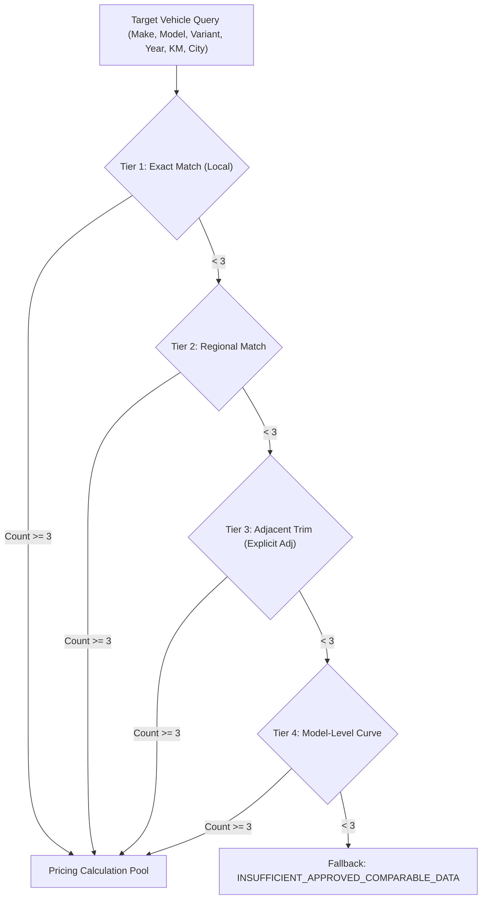

# V MOTIV V2 — Market Comparable Matching Engine

## 1. Multi-Tier Fallback Hierarchy

The Comparable Matching Engine identifies the most relevant historical transactions and market observations for a target vehicle using a strictly defined, explainable hierarchy:

---

## 2. Match Tier Definitions

### Tier 1: Local Exact Match (Highest Precision)
* **Filters**:
  * $\text{Make} = \text{Target.Make}$
  * $\text{Model} = \text{Target.Model}$
  * $\text{Variant} = \text{Target.Variant}$ (Exact trim match)
  * $\text{FuelType} = \text{Target.FuelType}$ (Exact match)
  * $\text{Transmission} = \text{Target.Transmission}$ (Exact match)
  * $\text{City} = \text{Target.City}$
  * $|\text{Year} - \text{Target.Year}| \le 1$
  * $|\text{KM} - \text{Target.KM}| \le 25,000\text{ km}$ or $30\%$ of target KM
* **Result**: If $N \ge 3$, calculation proceeds with local exact comparables.

### Tier 2: Regional Exact Match (Geographical Expansion)
* If Tier 1 produces $< 3$ records, city boundary is widened to the approved geographic cluster (e.g., Bengaluru $\to$ Karnataka State / South India Hubs).
* A regional location adjustment factor is applied based on historical RTO transfer parity.

### Tier 3: Adjacent Trim with Explicit Equipment Adjustments
* If Tier 2 produces $< 3$ records, adjacent trim levels within the same model/generation/fuel/powertrain are considered (e.g., matching a Creta `SX` to `SX (O)`).
* **Explicit Adjustment**: The known price delta of missing/additional equipment (e.g., panoramic sunroof, ADAS suite, ventilated seats) is explicitly deducted or added from the comparable price.
* The adjustment reason and paise amount are recorded immutably in the valuation snapshot lineage.

### Tier 4: Model-Level Segment Benchmark
* If Tier 3 produces $< 3$ records, the broader model curve is consulted only if at least 5 observations exist for the model family with identical fuel type and transmission.

### Tier 5: Insufficient Evidence Fallback
* If fewer than 3 defensible records exist across Tiers 1–4, the engine does **not** broaden criteria further.
* Returns `estimateAvailable = false` with code `INSUFFICIENT_APPROVED_COMPARABLE_DATA`.
* It never invents a market price or returns a synthetic estimate.

---

## 3. Strict Non-Negotiable Matching Rules

1. **Zero Powertrain Cross-Matching**: The engine strictly forbids matching:
   * `PETROL` with `DIESEL` (differing depreciation curves and Green Tribunal lifecycle rules, e.g., 10-year diesel cap in Delhi NCR).
   * `MANUAL` with `AUTOMATIC` (substantial transmission replacement and market preference premium).
   * `ICE` (Internal Combustion) with `EV` (Electric Vehicle battery health considerations).
2. **Double-Depreciation Prevention**:
   * If exact-year comparables ($|\text{Year} - \text{Target.Year}| = 0$) are used, age-depreciation is set to $0\%$.
   * Age depreciation is never applied twice (once via comparable year selection and once via an arbitrary annual percentage rule).
3. **Composite Scoring Weight**:
   Each eligible comparable $i$ receives a weight:
   $$W_i = w_{\text{source}} \cdot w_{\text{recency}} \cdot w_{\text{km\_distance}} \cdot w_{\text{geo}}$$
   where:
   * $w_{\text{source}} \in [0.4, 1.0]$ based on data source priority.
   * $w_{\text{recency}} = \exp(-\Delta t \cdot \ln(2) / 90)$.
   * $w_{\text{km\_distance}} = \max\left(0.5, 1 - \frac{|\text{KM}_i - \text{Target.KM}|}{100,000}\right)$.
   * $w_{\text{geo}} = 1.0$ (Same City) or $0.85$ (Regional cluster).
