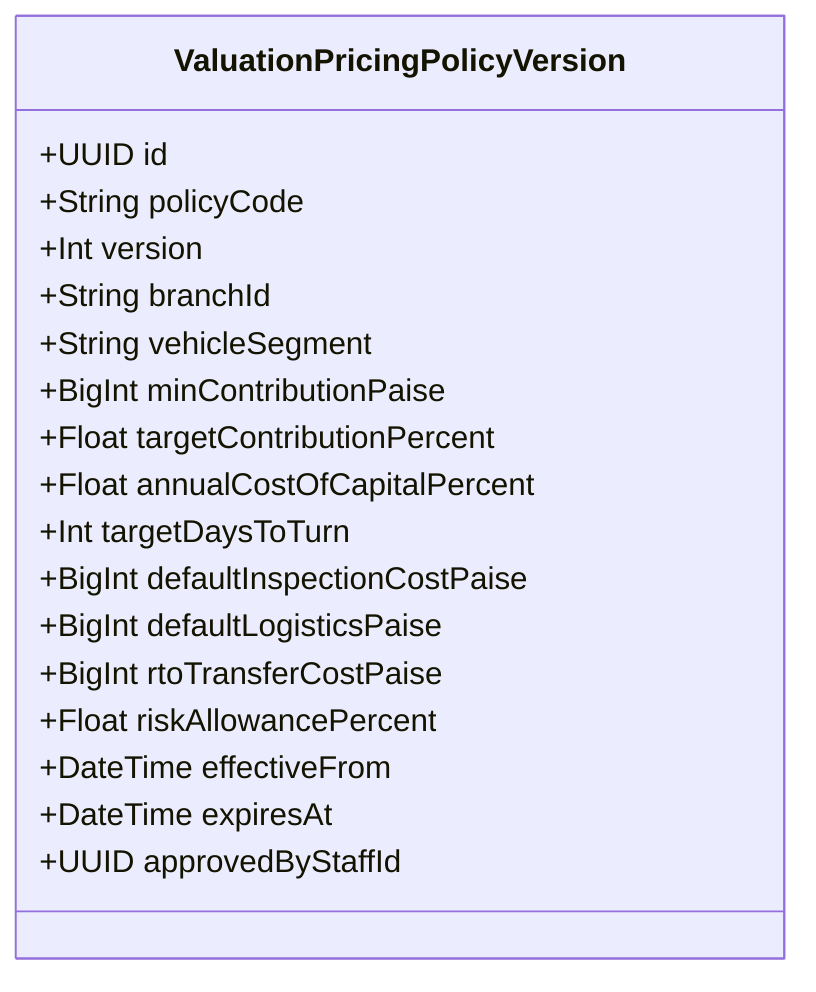

# V MOTIV V2 — Acquisition Cost & Margin Policy Framework

## 1. Governance & Versioning

All economic parameters used by the valuation engine are governed by centrally approved, versioned policy documents (`ValuationPricingPolicyVersion`). No pricing formula may hardcode secret margins or cost values directly in frontend code or API handlers.

---

## 2. Itemized Cost Components

### A. Procurement & Inward Logistics ($C_{\text{logistics}}$)
* **Doorstep vs Hub Evaluation**: Includes driver dispatch or technician transit.
* **Towing & Recovery**: Standard allocation if vehicle is non-drivable.
* **RTO Legal Title Transfer**: Form 29/30 processing, NOC clearance, hypothecation termination charges.

### B. Inventory Holding & Capital Carrying Cost ($C_{\text{holding}}$)
Calculated based on V MOTIV's corporate weighted average cost of capital ($WACC$):
$$C_{\text{holding}} = P_{\text{purchase}} \times \left(\frac{r_{\text{capital}}}{365}\right) \times T_{\text{days\_to\_turn}}$$
* **Default Values**:
  * $r_{\text{capital}} = 10.5\%\text{ per annum}$.
  * $T_{\text{days\_to\_turn}}$:
    * High-liquidity volume hatchbacks (e.g. Swift, Baleno): $25\text{ days}$.
    * Mid-size SUVs (e.g. Creta, Seltos, Nexon): $35\text{ days}$.
    * Premium / Luxury (e.g. BMW 3 Series, Mercedes C-Class): $60\text{ days}$.

### C. Certified Warranty & Risk Allowance ($R_{\text{warranty}}$)
* Covers post-sale warranty claims under V MOTIV's 1-Year / 15,000 km warranty.
* Segment-based percentage:
  * Low-risk naturally aspirated petrol: $1.5\%$ of expected retail price.
  * Turbocharged direct-injection / Dual-clutch automatics: $2.5\%$ of expected retail price.
  * Luxury / Multi-airmatic suspension: $4.0\%$ of expected retail price.

### D. Target Contribution Margin ($M_{\text{target}}$)
* Formulated as:
  $$M_{\text{target}} = \max\left(\text{MinContributionFloor}, \hat{P}_{\text{retail}} \times \text{TargetMarginPercent}\right)$$
* **Policy Floor**: Prevents low-value vehicles from generating negligible gross profit that fails to cover branch overheads.

---

## 3. Financial Delegation Authority (Approval Matrix)

Any deviation from the calculated economic ceiling requires explicit approval under the maker-checker hierarchy:

| Over-Ceiling Variance | Required Authority Level | Mandatory Documentation |
| :--- | :--- | :--- |
| $\le 0\%$ (Within economic ceiling) | Pricing Analyst / Acquisition Manager | Standard inspection review notes. |
| $+0.1\%$ to $+3.0\%$ (Moderate exception) | Senior Pricing Manager / Hub GM | Market comparable justification & liquidity note. |
| $+3.1\%$ to $+7.0\%$ (Major commercial exception) | Head of Automotive Pricing / VP Operations | Executive sign-off with strategic rationale. |
| $> +7.0\%$ (Strictly Disallowed) | Unapprovable by system rule | System automatically rejects transaction. |

---

## 4. Confidentiality & Security

* **Frontend Secrecy**: Policy versions, margin floors, and carrying cost rates are never exposed in customer mobile responses or publicly accessible JSON.
* **Auditing**: Every applied policy version is stamped immutably onto `InstantValuationSnapshot.policyVersion` and `AcquisitionValuation`.
