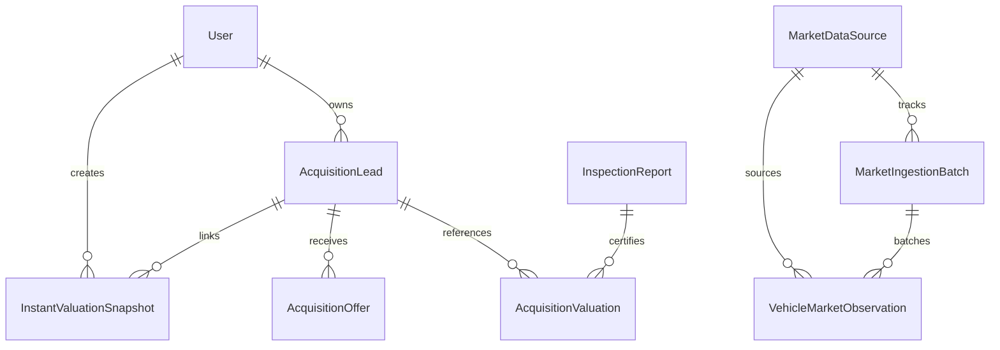

# V MOTIV V2 — Valuation Relational Database Schema

## 1. Schema Overview

The valuation engine extends PostgreSQL through Prisma with provenance-centric models. It is designed for append-only immutability of decision snapshots and full foreign key traceability.



---

## 2. Table Definitions & Constraints

### A. `MarketDataSource`
Tracks legal agreements and licensing status of market observation providers.
```prisma
model MarketDataSource {
  id                    String                   @id @default(uuid()) @db.Uuid
  key                   String                   @unique
  displayName           String
  provenanceNote        String
  permittedForValuation Boolean                  @default(false)
  active                Boolean                  @default(true)
  createdAt             DateTime                 @default(now())
  updatedAt             DateTime                 @updatedAt
  observations          VehicleMarketObservation[]
  ingestionBatches      MarketIngestionBatch[]
}
```

### B. `MarketIngestionBatch`
Maintains audit logs and quarantine metrics for imported datasets.
```prisma
model MarketIngestionBatch {
  id                  String                   @id @default(uuid()) @db.Uuid
  sourceId            String                   @db.Uuid
  source              MarketDataSource         @relation(fields: [sourceId], references: [id], onDelete: Restrict)
  sourceVersion       String?
  importedByUserId    String?                  @db.Uuid
  importedAt          DateTime                 @default(now())
  totalRecords        Int                      @default(0)
  acceptedRecords     Int                      @default(0)
  quarantinedRecords  Int                      @default(0)
  rejectionSummary    Json                     @default("{}")
  observations        VehicleMarketObservation[]

  @@index([sourceId, importedAt])
}
```

### C. `VehicleMarketObservation`
Stores atomic normalized pre-owned vehicle price points.
```prisma
model VehicleMarketObservation {
  id                String                         @id @default(uuid()) @db.Uuid
  sourceId          String                         @db.Uuid
  batchId           String?                        @db.Uuid
  source            MarketDataSource               @relation(fields: [sourceId], references: [id], onDelete: Restrict)
  batch             MarketIngestionBatch?          @relation(fields: [batchId], references: [id], onDelete: SetNull)
  externalReference String?
  duplicateKey      String?
  make              String
  model             String
  variant           String?
  manufacturingYear Int
  fuelType          String
  transmission      String
  odometerKm        Int
  city              String
  pricePaise        BigInt
  currency          String                         @default("INR")
  priceType         MarketObservationPriceType
  conditionBasis    String?
  observedAt        DateTime
  qualityStatus     MarketObservationQualityStatus @default(PENDING_REVIEW)
  qualityNotes      String?
  createdAt         DateTime                       @default(now())

  @@index([make, model, variant, city, observedAt])
  @@index([qualityStatus, observedAt])
  @@index([sourceId, externalReference])
}
```

### D. `InstantValuationSnapshot`
Immutable record of customer-declared vehicle parameters and public estimate outputs.
```prisma
model InstantValuationSnapshot {
  id                     String                      @id @default(uuid()) @db.Uuid
  userId                 String                      @db.Uuid
  leadId                 String?                     @db.Uuid
  user                   User                        @relation(fields: [userId], references: [id], onDelete: Restrict)
  lead                   AcquisitionLead?            @relation(fields: [leadId], references: [id], onDelete: SetNull)
  inputSnapshot          Json
  estimateAvailable      Boolean                     @default(false)
  unavailableReason      String?
  sellerEstimateLowPaise BigInt?
  sellerEstimateHighPaise BigInt?
  confidence             ValuationConfidenceCategory @default(INSUFFICIENT)
  comparableCount        Int                         @default(0)
  dataAsOf               DateTime?
  valuationVersion       String
  policyVersion          String?
  assumptions            Json                        @default("[]")
  createdAt              DateTime                    @default(now())

  @@index([userId, createdAt])
  @@index([leadId, createdAt])
}
```

---

## 3. Migration Provenance

* **Migration Name**: `20261030170000_valuation_data_foundation`
* **Path**: [`services/api/prisma/migrations/20261030170000_valuation_data_foundation/migration.sql`](file:///c:/Users/hp%20victus/Documents/V%20Motiv/vmotiv-v2/services/api/prisma/migrations/20261030170000_valuation_data_foundation/migration.sql)
* **Execution**: Applied non-destructively alongside existing V2 core schemas.
