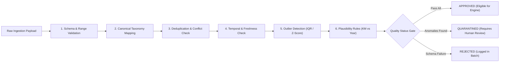

# V MOTIV V2 — Valuation Data Quality & Ingestion Pipeline

## 1. Automated Quality Pipeline

To prevent garbage-in garbage-out failure modes, all market observations pass through a rigorous 8-stage automated gate before being accepted into the pricing pool:

---

## 2. Ingestion Rules & Validation Criteria

### Stage 1: Schema & Numeric Boundary Checks
* **Price Validation**:
  * Must be positive integer value in paise (`pricePaise > 0`).
  * Absolute floor: ₹25,000 (2,500,000 paise).
  * Absolute ceiling: ₹50,00,00,000 (5,00,00,00,000 paise).
* **Year Constraints**:
  * $1980 \le \text{manufacturingYear} \le \text{CurrentYear} + 1$.
  * If $\text{registrationYear}$ is present: $\text{registrationYear} \ge \text{manufacturingYear}$.
* **Odometer Constraints**:
  * $0 \le \text{odometerKm} \le 1,500,000$.

### Stage 2: Canonical Automotive Taxonomy Mapping
* Uses standardized lookup tables for:
  * **Brand**: Exact casing match against canonical master (e.g., `Maruti`, `Maruti-Suzuki`, `Suzuki` $\to$ `Maruti Suzuki`).
  * **Model**: Strips marketing prefixes/suffixes (e.g., `All New Creta 2020` $\to$ `Creta`).
  * **Fuel Type**: Standardized to `PETROL`, `DIESEL`, `CNG`, `ELECTRIC`, `HYBRID`.
  * **Transmission**: Standardized to `MANUAL`, `AUTOMATIC`.
  * **City / RTO**: Standardized to metropolitan cluster (e.g., `Whitefield`, `Koramangala`, `Bangalore` $\to$ `Bengaluru`).

### Stage 3: Deterministic Deduplication
* Generates a composite hash key for each record:
  $$\text{Hash} = \text{SHA256}(\text{sourceId} + \text{make} + \text{model} + \text{variant} + \text{year} + \text{fuel} + \text{trans} + \text{city} + \lfloor\text{km}/1000\rfloor + \lfloor\text{price}/10000\rfloor)$$
* Identical keys observed within a 14-day rolling window from the same source are tagged as duplicate and quarantined.

### Stage 4: Freshness & Temporal Decay Weighting
* Pre-owned car values change with seasonal demand and new car price adjustments.
* Observations are weighted by an exponential decay half-life ($t_{1/2} = 90\text{ days}$):
  $$w_{\text{recency}} = \exp\left(-\frac{\Delta t \cdot \ln(2)}{90}\right)$$
  where $\Delta t$ is days elapsed since $\text{observedAt}$.
* Records older than 180 days are excluded from high-confidence matching unless market liquidity is critically low.

### Stage 5: Statistical Outlier Tagging
* For any cluster with $N \ge 6$ comparables:
  * Calculates First Quartile ($Q_1$), Third Quartile ($Q_3$), and Interquartile Range ($\text{IQR} = Q_3 - Q_1$).
  * Any price outside $[Q_1 - 1.5 \cdot \text{IQR}, Q_3 + 1.5 \cdot \text{IQR}]$ is tagged as `OUTLIER_PRICE` and quarantined.

### Stage 6: Kinematic Plausibility Checks
* **Odometer / Age Correlation**:
  $$\text{AnnualMileage} = \frac{\text{odometerKm}}{\max(1, \text{CurrentYear} - \text{manufacturingYear})}$$
  * If $\text{AnnualMileage} > 120,000\text{ km/yr}$ or ($\text{AnnualMileage} < 300\text{ km/yr}$ for cars $> 3\text{ years}$ old), the record is quarantined for suspicious odometer reading.

---

## 3. Quarantine and Audit Workflow

* Records that fail validation are stored in `VehicleMarketObservation` with `qualityStatus = 'QUARANTINED'` and a descriptive `qualityNotes` JSON payload.
* An authorized Data Analyst can review quarantined records in the operations portal to either:
  1. Correct mapping errors and transition status to `APPROVED`.
  2. Confirm invalidity and transition status to `REJECTED`.
* Under no circumstances can unreviewed or quarantined observations affect customer estimates or pricing recommendations.
