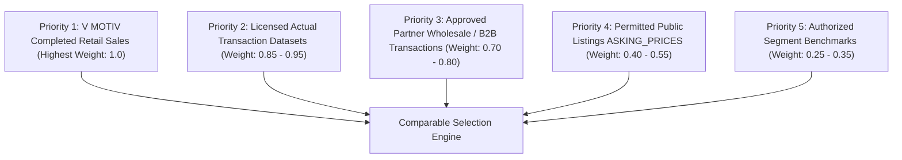

# V MOTIV V2 — Valuation Data Sources & Provenance Architecture

## 1. Quality-Ranked Data Hierarchy

To ensure accuracy, financial prudence, and legal defensibility, all valuation calculations in V MOTIV V2 must derive from ranked, verified data sources. Data is ingested into `VehicleMarketObservation` records with mandatory provenance metadata.

### Priority 1: V MOTIV Completed Retail Sales
* **Nature**: Actual closed retail sales contracts executed through V MOTIV showrooms and digital checkouts (`VehicleSale` linked to `VehicleStockUnit`).
* **Attributes**: Exact realized transaction price, known refurbishment cost, certified physical condition, days on lot, and warranty package.
* **Weight**: Primary ground truth (relative weight: 1.00).

### Priority 2: Licensed Third-Party Transaction Datasets
* **Nature**: Commercially licensed pre-owned automotive transaction databases provided by institutional data providers under contract.
* **Attributes**: Must contain verified sale prices, RTO registration transfer records, and verified transaction dates.
* **Weight**: High trust (relative weight: 0.85 to 0.95).

### Priority 3: Partner B2B / Wholesale Transactions
* **Nature**: Verified wholesale, auction, or dealer clearing transactions with approved institutional remarketing partners.
* **Attributes**: Explicitly labeled `DEALER_WHOLESALE` or `AUCTION`. Normalization formulas apply to model wholesale-to-retail margins.
* **Weight**: Moderate-to-high trust (relative weight: 0.70 to 0.80).

### Priority 4: Permitted Comparable Public Listings
* **Nature**: Publicly advertised classified listings from authorized portals operating under clear contractual terms or public APIs.
* **Mandatory Labeling**: Must be permanently tagged `priceType = ASKING_PRICE`.
* **Normalization Requirement**: Must never be used as realized transaction prices. A statistically calibrated listing-to-transaction discount factor is applied.
* **Weight**: Contextual / directional (relative weight: 0.40 to 0.55).

### Priority 5: Authorized Internal Market Benchmarks
* **Nature**: Centrally approved price curves and segment indices established by V MOTIV's Chief Pricing Analyst for low-liquidity segments.
* **Governance**: Must have an explicit version number, authorized approver ID, and quarterly expiration date.

---

## 2. Ingestion Schema & Provenance Metadata

Every single observation ingested into the PostgreSQL database via Prisma must satisfy the `VehicleMarketObservation` schema:

| Field Name | Data Type | Constraints & Description |
| :--- | :--- | :--- |
| `id` | `UUID` | Primary Key, auto-generated. |
| `sourceId` | `UUID` | Foreign Key to `MarketDataSource(id)` (mandatory). |
| `batchId` | `UUID` | Foreign Key to `MarketIngestionBatch(id)` (nullable). |
| `externalReference` | `String` | Unique ID in the provider's dataset for traceability. |
| `duplicateKey` | `String` | Normalized composite key: `make:model:trim:year:fuel:trans:city:km_bin:price_bin`. |
| `make` | `String` | Canonical brand name (e.g., `Hyundai`, `Maruti Suzuki`). |
| `model` | `String` | Canonical model name (e.g., `Creta`, `Swift`). |
| `variant` | `String` | Canonical trim level (e.g., `SX (O)`, `ZXi+`). Nullable for base trims. |
| `manufacturingYear` | `Int` | Integer between 1980 and current year + 1. |
| `fuelType` | `String` | Enum string: `PETROL`, `DIESEL`, `CNG`, `ELECTRIC`, `HYBRID`. |
| `transmission` | `String` | Enum string: `MANUAL`, `AUTOMATIC`. |
| `odometerKm` | `Int` | Mileage in kilometres at observation time. |
| `city` | `String` | Operating RTO / metropolitan market (e.g., `Bengaluru`, `Delhi`). |
| `pricePaise` | `BigInt` | Price in Indian Paise (INR $\times$ 100) to ensure exact precision. |
| `currency` | `String` | Default: `'INR'`. |
| `priceType` | `Enum` | `ASKING_PRICE`, `COMPLETED_TRANSACTION`, `AUCTION`, `DEALER_WHOLESALE`, `OTHER`. |
| `conditionBasis` | `String` | Declared condition basis (e.g., `FAIR`, `GOOD`, `EXCELLENT`, `REFURBISHED`). |
| `observedAt` | `DateTime` | Wall-clock timestamp when the transaction occurred or listing was active. |
| `qualityStatus` | `Enum` | `PENDING_REVIEW`, `APPROVED`, `QUARANTINED`, `REJECTED`. |
| `qualityNotes` | `String` | Reviewer notes or automated validation error tags. |

---

## 3. Compliance & Anti-Scraping Safeguards

1. **No Unauthorized Web Scraping**: The system strictly forbids scraping competitor websites (e.g., Spinny, Cars24, CarDekho) or breaching terms of service.
2. **Provenance Traceability**: An observation cannot enter the calculation pool without an active `MarketDataSource` where `permittedForValuation = true` and `active = true`.
3. **No Synthetic Training Records**: Under no circumstances should an LLM or synthetic data generator be used to invent pre-owned car sales or prices.
4. **Data Isolation & Gating**: If a vehicle has fewer than 3 approved observations in its matching cluster, the engine returns `estimateAvailable = false` with code `INSUFFICIENT_APPROVED_COMPARABLE_DATA`.
