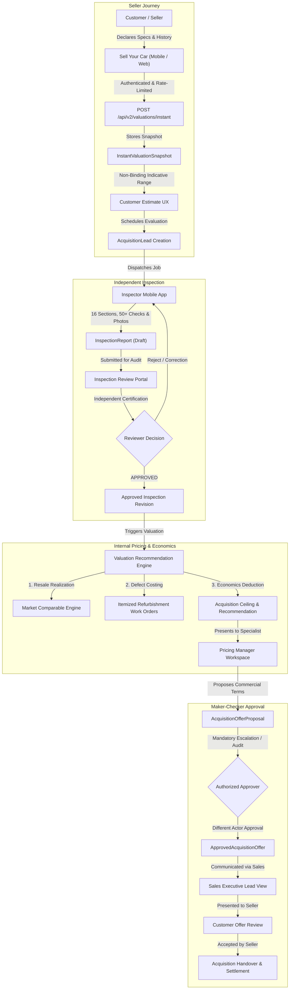

# V MOTIV V2 — Intelligent Used-Car Valuation & Acquisition Pricing Architecture

## 1. Executive Summary & Core Purpose

V MOTIV V2 operates a closed-loop automotive acquisition, refurbishment, and retail inventory model. The Intelligent Valuation & Acquisition Pricing Engine is designed to bridge the trust gap between initial digital self-declarations by sellers and auditable, financially grounded acquisition offers.

The platform deliberately separates public customer estimations from internal acquisition recommendations and authorized commercial offers. It enforces a strict maker-checker approval hierarchy and guarantees that no financial commitment is ever generated without an independently certified physical inspection and an explicit review by an authorized pricing manager.

---

## 2. Four Distinct Price Concepts

The platform strictly isolates four distinct pricing concepts at the schema, logic, and UI levels. They are never conflated or used interchangeably:

### A. Market Retail Value (MRV)
* **Definition**: The expected transaction price at which a comparable vehicle would sell to an end-user retail buyer in the specified geographical micro-market under standard retail warranty and certification conditions.
* **Basis**: High-trust historical completed retail sales, certified partner reference transactions, and normalized retail listings adjusted for transaction discounts and holding durations.
* **Consumer**: Internal inventory planning and economics calculations only. Never represented to the seller as their payout.

### B. Instant Seller Payout Estimate (ISPE)
* **Definition**: A transparent, approximate net payout range that a seller might receive from V MOTIV before an in-person physical inspection.
* **Basis**: Expected market retail realization minus standardized holding costs, typical preparation buffers, target commercial gross margin, and condition uncertainty allowances.
* **Consumer**: Customer-facing mobile application and web portal.
* **Legal Status**: Strictly non-binding indicative estimate. Explicitly disclaims warranty and does not constitute a legal offer.

### C. Internal Acquisition Recommendation (IAR)
* **Definition**: An algorithmic, data-grounded suggestion for the maximum prudent purchase price V MOTIV could offer after physical inspection.
* **Basis**: Verified identity (Make/Model/Trim/Year/Odometer), documented defect lines from the approved inspection report, evidence-linked refurbishment cost estimates, logistics, holding depreciation, and segment contribution targets.
* **Consumer**: Authorized Pricing Managers and Acquisition Analysts.
* **Status**: Internal decision support. Does not generate an offer automatically.

### D. Approved Purchase Offer (APO)
* **Definition**: The binding commercial purchase offer issued to the customer with an immutable version number, expiration date, and explicit terms.
* **Basis**: Human review of the Internal Acquisition Recommendation, comparable evidence, defect photos, and authorized policy overrides.
* **Authorization**: Requires a distinct Pricing Approver (Maker-Checker enforcement) holding appropriate financial delegation authority.

---

## 3. End-to-End Domain Boundaries & Gap Matrix

| Domain & Workflow Area | Current Status | Implemented Component & Evidence | Open Dependencies & Next Order |
| :--- | :--- | :--- | :--- |
| **Seller Vehicle Submission** | `VERIFIED_WORKING` | `apps/customer-mobile/src/screens/SellScreen.tsx`, `AcquisitionLead` | Full 7-step guided questionnaire with brand logos, trim, fuel, and registration plate. |
| **Customer Valuation Snapshot API** | `VERIFIED_WORKING` | `POST /api/v2/valuations/instant`, `services/api/src/valuation-store.ts` | Authenticated, rate-limited, ownership-scoped immutable `InstantValuationSnapshot`. |
| **Customer Estimate Presentation** | `VERIFIED_WORKING` | `SellScreen.tsx` Review Step | Data-gated presentation; displays clear non-binding disclaimer and review notice. |
| **Inspector App & Physical Checks** | `VERIFIED_WORKING` | `apps/inspector-mobile`, `services/api/src/inspection-router.ts` | 16-section checklist, 14 photo slots, defect severity tagging, and road test declarations. |
| **Independent Inspection Review** | `VERIFIED_WORKING` | `apps/inspection-review-portal` (`ops.vmotiv.in`) | Formal reviewer gate; enforces self-approval prohibition; generates immutable `APPROVED` revisions. |
| **Offer Authorization Boundary** | `VERIFIED_WORKING` | `services/api/src/sales-store.ts`, `services/api/test/acquisition-authorization.test.ts` | Disallows Sales Executives from forging inspections or self-issuing unapproved offers. |
| **Valuation Unit & Security Suite** | `VERIFIED_WORKING` | `services/api/test/valuation-api.test.ts` | 5/5 passing tests covering rate limits, ownership checks, and data-gating. |
| **Market Data Provenance Schema** | `IMPLEMENTED_DATA_GATED` | `MarketDataSource`, `MarketIngestionBatch`, `VehicleMarketObservation` | PostgreSQL / Prisma schema supporting 5 price types, batch tracking, and quality status. |
| **Lawful Market Data Ingestion** | `BLOCKED` | `docs/VALUATION_DATA_SOURCES.md` | Blocked until contract execution with licensed automotive data provider or completed V MOTIV sales. |
| **Versioned Pricing Cost Policy** | `NOT_IMPLEMENTED` | `docs/VALUATION_COST_POLICY.md` | Policy schema and branch-level margin threshold configuration. |
| **Defect Cost Deduction Engine** | `PARTIALLY_IMPLEMENTED` | `InspectionDefect`, `AcquisitionValuation` | Scalar cost fields exist; itemized shop work order linking required. |
| **Pricing Manager Workspace** | `PARTIALLY_IMPLEMENTED` | Operations Portal / Sales Portal | Valuation review UI for maker-checker offer proposals and escalation. |

---

## 4. Architectural Safety Boundaries

1. **Zero Data Fabrication**: Under no circumstances does the engine fabricate transaction records, invent competitor prices, generate random confidence intervals, or display magic numbers when evidence is absent.
2. **Mandatory Inspection Precondition**: No internal acquisition price or commercial offer may be generated from uninspected, draft, or rejected inspections.
3. **No Automatic Offer Issuance**: The valuation algorithm never commits company capital autonomously. Every purchase offer requires authorized human approval.
4. **Segregation of Duties (Maker-Checker)**: A user cannot approve their own proposed offer. Sales staff and Inspectors cannot approve acquisition purchase offers.
5. **Money Safety**: All financial values are modeled in Indian Paise (`BigInt`) to prevent IEEE-754 floating point inaccuracies.
