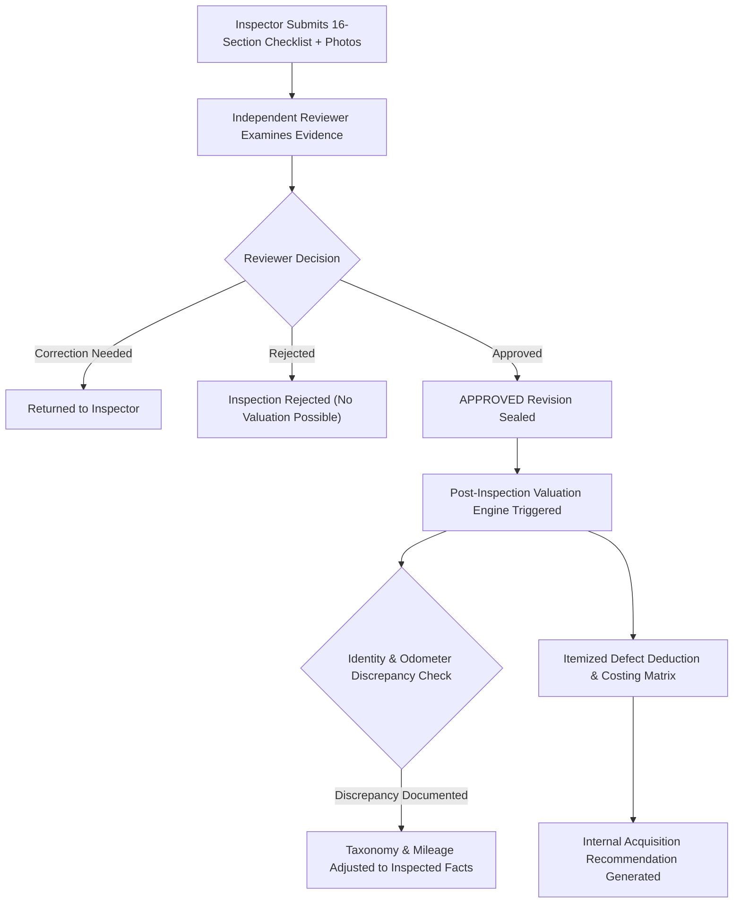

# V MOTIV V2 — Post-Inspection Valuation & Defect Cost Engine

## 1. Physical Inspection as an Uncompromising Precondition

The V MOTIV platform strictly forbids issuing internal acquisition recommendations or purchase offers based on uninspected seller claims. An internal valuation recommendation can **only** be triggered against an `InspectionReport` that has achieved `status = 'APPROVED'` through the independent Inspection Review Portal ([`apps/inspection-review-portal`](file:///c:/Users/hp%20victus/Documents/V%20Motiv/vmotiv-v2/apps/inspection-review-portal)).

---

## 2. Verified Vehicle Identity Ingestion

When an inspection revision is approved, the valuation engine ingests inspected facts as authoritative ground truth, overriding customer self-declarations:

1. **Odometer Reading**: Verified against the physical gauge cluster photograph (`identity.odometerKm`).
2. **True Variant & Powertrain**: Derived from the vehicle VIN plate, RC book, and engine bay badge.
3. **Registration & Manufacturing Year**: Confirmed via the Ministry of Road Transport & Highways (MoRTH) RC record.
4. **Discrepancy Audit**: If customer declared `40,000 km` but inspection reveals `92,000 km`, the engine records a structured discrepancy event in `LeadInteraction` and bases all calculations on $92,000\text{ km}$.

---

## 3. Defect Classification & Costing Engine

Every defect logged in the 16 inspection sections carries a category, severity, and component location:

| Severity Level | Definition | Standard Action | Typical Cost Basis |
| :--- | :--- | :--- | :--- |
| **`MINOR`** | Superficial cosmetic blemish (hairline scratch, stone chip, soiled upholstery). | Touch-up / Detailing. | Standard internal rate (e.g., ₹800–₹1,500/panel). |
| **`MODERATE`** | Wear-and-tear component requiring replacement (worn brake pads, deep panel dent, weak battery). | Mechanical / Bodyshop repair. | Standard OEM / OES parts catalogue + fixed labour. |
| **`MAJOR`** | Substantial subsystem impairment (AC compressor failure, clutch slippage, suspension knocking). | Component overhaul. | Verified workshop quotation table. |
| **`CRITICAL`** | Structural damage, deployed airbags, flood damage, engine compression loss. | High-risk failure. | **Blocks automatic recommendation** (`ACQUISITION_BLOCKED`). |

### Overlapping Defect Reconciliation
To prevent unfair compounding deductions against the seller:
* If multiple defect entries reference the same component (e.g., "Left Front Fender Scratched" and "Left Front Fender Dented"), the engine consolidates them into a single panel repair work order (`DENT_REPAIR_AND_PAINT`) rather than applying two separate paint deductions.

---

## 4. Hard Blockers & Safety Rejections

The engine immediately halts recommendation generation and flags `valuationStatus = 'BLOCKED'` with an explicit human alert under the following conditions:
1. **Structural / Chassis Compromise**: Evidence of apron repair, cut pillar, or floor pan straightening.
2. **Flood Damage**: Rust lines behind the dashboard, mud inside wiring harnesses, or waterlogged ECUs.
3. **Engine Seizure / Metal Shavings**: Severe internal mechanical failure.
4. **Odometer Tampering**: Physical cluster screw marks with contradictory service centre telemetry.

Such vehicles are designated non-retail and can only be routed to commercial salvage remarketing with senior executive sign-off.
