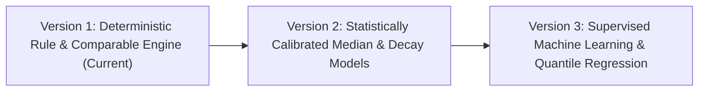

# V MOTIV V2 — Valuation Model Development, Evaluation & Learning Pipeline

## 1. Phased Model Evolution

To avoid deploying ungrounded machine learning models without sufficient training data, the valuation engine follows a strict phased maturity lifecycle:

### Version 1: Deterministic Comparable Matching (Current Production Base)
* **Mechanisms**: Explicit multi-tier fallback, weighted medians, and itemized defect deductions.
* **Advantages**: $100\%$ explainable, zero black-box drift, fully auditable for every rupee deducted or added.
* **Data Requirement**: Requires at least 3 approved observations per cluster to emit a value.

### Version 2: Statistically Calibrated Curves (Mid-Term)
* **Mechanisms**: Calibrates segment-level depreciation curves and negotiation discount factors ($\delta_{\text{asking}}$) against actual closed sales in `VehicleSale`.
* **Deployment Gate**: Minimum 500 completed V MOTIV retail sales transactions across target cities.

### Version 3: Supervised Machine Learning (Long-Term)
* **Candidate Architectures**: LightGBM / XGBoost Regressors and Quantile Regression ($10\text{th}, 50\text{th}, 90\text{th}$ percentiles).
* **Deployment Gate**: Minimum 5,000 certified historical acquisition and retail records with complete inspection feature vectors.

---

## 2. Prevention of Target Leakage

The evaluation framework enforces strict temporal and situational feature isolation:

1. **Pre-Inspection Feature Isolation**: The public instant estimate model ($M_{\text{public}}$) strictly receives only customer-declared fields available before inspection. It is **never** trained on or evaluated against:
   * Post-inspection defect registers or checklist answers.
   * Inspection photos or technician ratings.
   * Internal economic margin policies.
2. **Post-Valuation Isolation**: The training pipeline strictly utilizes temporal train/test splits ($\text{Train} < T_{\text{cutoff}} \le \text{Test}$). Data from after the valuation timestamp is blocked.
3. **Outcome Separation**: The model evaluates three distinct commercial outcomes separately:
   * **Task A**: Predicted Retail Realization vs Realized Retail Sale Price.
   * **Task B**: Pre-Inspection Estimate Range vs Approved Purchase Offer.
   * **Task C**: Recommended Purchase Amount vs Final Realized Margin.

---

## 3. Evaluation Metrics & Benchmarks

The model evaluation pipeline measures performance using robust, non-parametric statistical metrics:

| Metric | Formula | Target Threshold | Purpose |
| :--- | :--- | :--- | :--- |
| **MdAPE** | $\text{Median}\left(\left|\frac{\hat{y}_i - y_i}{y_i}\right|\right) \times 100\%$ | $\le 6.5\%$ | Median absolute percentage error resistant to extreme outliers. |
| **MAE** | $\frac{1}{N}\sum_{i=1}^N |\hat{y}_i - y_i|$ | $\le \text{₹25,000}$ (Mass) / $\le \text{₹60,000}$ (Luxury) | Mean absolute error in Indian Rupees. |
| **Systemic Bias** | $\frac{1}{N}\sum_{i=1}^N (\hat{y}_i - y_i)$ | Within $[-1.5\%, +1.5\%]$ | Ensures predictions are neither systematically over-bidding nor under-bidding. |
| **Coverage** | $\frac{1}{N}\sum_{i=1}^N \mathbb{I}(y_i \in [\text{Low}_i, \text{High}_i])$ | $\ge 82.0\%$ for $80\%$ interval | Empirical coverage rate of the estimated range. |

---

## 4. Rollback and Safe Fallback Gates

* Every valuation snapshot records `valuationVersion`.
* If production telemetry detects that MdAPE exceeds $10\%$ or systemic bias deviates beyond $\pm 3\%$ over a 7-day rolling window, the system automatically activates a rollback switch:
  `VALUATION_ENGINE_FALLBACK_TO_DETERMINISTIC_V1`
* Rolling back preserves full customer availability without halting lead intake or inspection operations.
