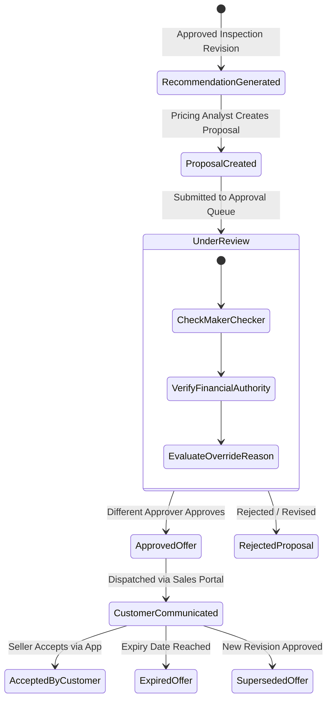

# V MOTIV V2 — Acquisition Offer Approval & Maker-Checker Workflow

## 1. Principles of Financial Authority

V MOTIV V2 strictly enforces the separation of valuation intelligence, commercial proposal, managerial approval, and customer acceptance. No software model, sales executive, or inspector possesses autonomous authority to issue binding purchase offers to vehicle sellers.

---

## 2. Segregation of Roles & Delegation Matrix

| Role | Valuation Creation | Offer Proposal | Offer Approval | Customer Communication |
| :--- | :---: | :---: | :---: | :---: |
| **Inspector** | ❌ No | ❌ No | ❌ No | ❌ No |
| **Sales Executive** | ❌ No | ❌ No | ❌ No | ✅ Yes (Approved Offers Only) |
| **Pricing Analyst (Maker)** | ✅ Yes (Automated Engine) | ✅ Yes | ❌ No (Cannot self-approve) | ❌ No |
| **Pricing Approver (Checker)** | ❌ No | ❌ No | ✅ Yes (Up to ₹25 Lakhs) | ❌ No |
| **Senior Approver / VP** | ❌ No | ❌ No | ✅ Yes (Above ₹25L or Exceptions) | ❌ No |
| **Customer / Seller** | ❌ No | ❌ No | ❌ No | ✅ Final Acceptance Authority |

---

## 3. Maker-Checker Enforcement Logic

When an offer proposal is created, the system records:
* `proposerId`: The employee ID of the pricing analyst initiating the offer.
* `proposedAmountPaise`: The exact purchase price offered in paise.
* `economicCeilingPaise`: The algorithmic ceiling from the recommendation.
* `reasonCode`: Mandatory code if amount deviates from recommendation (e.g., `COMPETITIVE_COUNTER_OFFER`, `PREMIUM_CONDITION_PANEL`, `URGENT_INVENTORY_NEED`).
* `writtenJustification`: Detailed textual explanation.

### Strict Approval Constraints
1. **Self-Approval Prohibition**: If `approverId == proposerId`, the API throws `HttpError(403, 'PROPOSER_CANNOT_SELF_APPROVE')`.
2. **Sales Barrier**: If a sales executive attempts to issue or approve an offer directly, the API throws `HttpError(403, 'OFFER_ISSUANCE_REQUIRES_PRICING_AUTHORITY')` (verified in [`services/api/test/acquisition-authorization.test.ts`](file:///c:/Users/hp%20victus/Documents/V%20Motiv/vmotiv-v2/services/api/test/acquisition-authorization.test.ts)).
3. **No Forged Acceptance**: Sales staff cannot mark an offer as "Accepted by Customer". Customer acceptance requires authenticated customer authorization matching the lead's owner (`SELLER_ACCEPTANCE_REQUIRES_CUSTOMER_AUTHENTICATION`).

---

## 4. Versioning and Expiration Integrity

* Every approved offer is assigned a sequential integer `version` (1, 2, 3...) and an expiration timestamp (`validUntil`, typically 5 calendar days).
* When a customer accepts an offer via mobile, the request payload must include `{ version: expectedVersion }`.
* If a new inspection or pricing revision occurs while the customer is reviewing, previous offers transition to `status = 'SUPERSEDED'`, preventing stale commitments.
