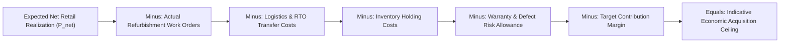

# V MOTIV V2 — Valuation Pricing & Economic Formulas

## 1. Mathematical Notation & Principles

All internal monetary calculations are conducted in integer Indian Paise (`BigInt`), where:
$$\text{Amount}_{\text{paise}} = \text{Round}(\text{Amount}_{\text{INR}} \times 100)$$

Floating-point representations (`float`, `double`) are strictly prohibited in calculation pipelines to prevent IEEE-754 precision drift.

---

## 2. Market Realization Formulas

### A. Price Type Normalization
Raw market observations have different transaction bases. They are converted into an equivalent expected retail realization:

$$P_{\text{norm}, i} = \begin{cases} 
P_{\text{raw}, i} \cdot (1 - \delta_{\text{asking}}) & \text{if } \text{priceType} = \text{ASKING\_PRICE} \\
P_{\text{raw}, i} & \text{if } \text{priceType} = \text{COMPLETED\_TRANSACTION} \\
P_{\text{raw}, i} \cdot (1 + \mu_{\text{wholesale\_markup}}) & \text{if } \text{priceType} \in \{\text{DEALER\_WHOLESALE}, \text{AUCTION}\}
\end{cases}$$

where:
* $\delta_{\text{asking}}$ is the empirical negotiation discount factor (typically $0.04$ to $0.07$, calibrated per segment).
* $\mu_{\text{wholesale\_markup}}$ is the wholesale-to-retail margin factor (typically $0.08$ to $0.12$).

### B. Weighted Central Retail Price ($\hat{P}_{\text{retail}}$)
Given $N$ normalized comparables with weights $W_i$, the engine sorts $P_{\text{norm}, (1)} \le P_{\text{norm}, (2)} \le \dots \le P_{\text{norm}, (N)}$ and identifies the weighted median:

$$\hat{P}_{\text{retail}} = P_{\text{norm}, (k)} \quad \text{such that} \quad \sum_{i=1}^{k-1} W_{(i)} < \frac{1}{2}\sum_{i=1}^N W_i \le \sum_{i=1}^k W_{(i)}$$

Dispersion is measured via the weighted interquartile range $[\hat{P}_{\text{retail, low}}, \hat{P}_{\text{retail, high}}]$ representing the $25\text{th}$ and $75\text{th}$ weighted percentiles.

---

## 3. Public Pre-Inspection Seller Payout Range (ISPE)

The public estimate presented to a customer on the mobile app is an approximate seller payout range, derived as:

$$\text{SellerEstimateLow} = \max\left(0, \hat{P}_{\text{retail, low}} - C_{\text{prep, high}} - C_{\text{holding}} - M_{\text{target}} - U_{\text{condition}}\right)$$

$$\text{SellerEstimateHigh} = \max\left(\text{SellerEstimateLow}, \hat{P}_{\text{retail}} - C_{\text{prep, low}} - C_{\text{holding}} - M_{\text{target}}\right)$$

where:
* $\hat{P}_{\text{retail}}$: Central expected retail realization.
* $C_{\text{prep, low}}, C_{\text{prep, high}}$: Standard statistical preparation and refurbishment buffer for uninspected cars in that vehicle segment.
* $C_{\text{holding}}$: Expected inventory carrying cost based on segment days-to-turn targets.
* $M_{\text{target}}$: Centrally approved target gross contribution.
* $U_{\text{condition}}$: Uncertainty buffer for customer self-declared condition.

---

## 4. Post-Inspection Economic Ceiling & Acquisition Price (IAR)

Following physical inspection and reviewer approval, actual defect observations replace statistical averages:

### The Economic Ceiling Equation
$$\text{Ceiling}_{\text{acquisition}} = \hat{P}_{\text{retail}} - C_{\text{refurb, actual}} - C_{\text{logistics}} - C_{\text{holding}} - R_{\text{warranty}} - M_{\text{target}}$$

### Suggested Acquisition Amount
$$\text{SuggestedPrice} = \min\left(\text{Ceiling}_{\text{acquisition}}, \hat{P}_{\text{retail}} \cdot (1 - \text{MarginFloor})\right)$$

### Key Rules
1. **No Negative Payout**: If $\text{Ceiling}_{\text{acquisition}} \le 0$, the vehicle is structurally or mechanically non-viable for retail; recommendation is flagged `ACQUISITION_UNECONOMIC`.
2. **Independent Approval Required**: The output of this formula is labeled `SUGGESTED_ACQUISITION_AMOUNT` in the Pricing Manager workspace. It is **never** dispatched automatically as a binding customer offer.
