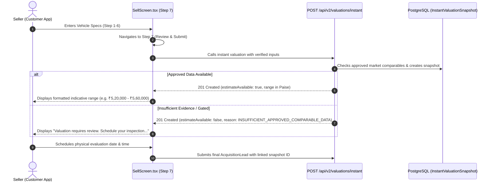

# V MOTIV V2 — Public Customer Estimate UX & Mobile Architecture

## 1. Customer User Experience Flow

The public estimation experience is integrated into the 7-step **Sell Your Car** journey in the V MOTIV Customer Mobile App ([`apps/customer-mobile/src/screens/SellScreen.tsx`](file:///c:/Users/hp%20victus/Documents/V%20Motiv/vmotiv-v2/apps/customer-mobile/src/screens/SellScreen.tsx)):

---

## 2. Screen States & Visual Design

### State 1: Active Calculation / Loading
When the customer arrives at Step 7, an asynchronous call is dispatched to the valuation endpoint:
* Visual indicator: Branded activity indicator with text:
  `Checking approved market evidence…`
* Accessibility: Uses `accessibilityLiveRegion="polite"` to inform screen readers without blocking form navigation.

### State 2: Active Indicative Range (When Approved Data Exists)
* **Title**: `Your estimated selling value`
* **Format**: Large, bold rupee range:
  `₹5,20,000 – ₹5,60,000`
* **Assumptions Callout**: Lists key assumptions:
  * Non-accidental, original paint body panels.
  * Mechanically sound powertrain and certified service records.
  * Valid RTO documentation with road tax cleared.
* **Mandatory Legal Disclaimer**:
  > *"This is an indicative estimate based on the details you provided and available market information. It is not a purchase offer. The amount V MOTIV may offer can change after vehicle inspection, document checks and market review."*

### State 3: Data-Gated / Review Required (Current Safe Default)
When approved licensed data or a versioned pricing policy is pending:
* **Presentation**: An informative, honest callout card:
  `Valuation requires review. Schedule the inspection and V MOTIV will assess approved market evidence and the vehicle’s verified condition.`
* **Actionable CTA**: Seamless progression to booking the free inspection slot.
* **Integrity Guarantee**: Never displays an arbitrary fake ₹1 or synthetic price.

---

## 3. Input Invalidation & State Synchronization

* **Input Hashing**: A composite key is constructed from:
  `[make, model, variant, year, regYear, odometer, fuel, transmission, city, owners, accident, service, loan].join('|')`
* **Instant Invalidation**: If the customer taps back to Step 1 or 2 to alter their odometer reading, trim, or manufacturing year, the previous estimate is discarded.
* **Immutable Snapshot**: When the lead is finally submitted, the authoritative snapshot ID is attached to `AcquisitionLead`, freezing the exact customer inputs and estimate version for historical audit.
