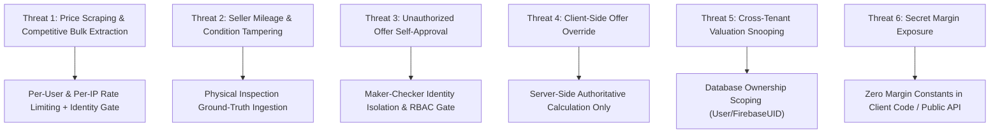

# V MOTIV V2 — Valuation Engine Security, Fraud & Abuse Prevention

## 1. Threat Matrix & Defensive Countermeasures

The valuation platform handles sensitive commercial pricing logic, proprietary margin structures, and direct capital deployment. It enforces rigorous defenses against six primary threat vectors:



---

## 2. Security Implementations & Code Controls

### A. Anti-Enumeration & Rate Limiting
* **Limiter**: Dedicated Express rate limiter on `/api/v2/valuations/instant`:
  * Limit: 12 requests per 60-second window per authenticated user.
* **Payload Validation**: Strict Zod schema enforces:
  * $0 \le \text{odometerKm} \le 2,000,000$.
  * Year bounds: $1980 \le \text{year} \le \text{CurrentYear} + 1$.
  * Super-refinement: Registration year cannot precede manufacturing year.

### B. Ownership Verification & Data Isolation
* An instant valuation snapshot can optionally link to an `AcquisitionLead`.
* The store strictly checks:
  ```ts
  const lead = await this.db.acquisitionLead.findFirst({
    where: { id: input.leadId, userId: user.id },
    select: { id: true },
  });
  if (!lead) throw new HttpError(404, 'LEAD_NOT_FOUND');
  ```
* A malicious user cannot probe or attach valuation records to another customer's enquiry.

### C. Client-Side Override Protection
* Commercial offer creation endpoints strictly reject client-supplied `approved` flags or arbitrary price assignments.
* Final purchase offers can **only** be created by backend service methods executing within an active PostgreSQL transaction after verifying that the linked inspection report is `APPROVED` and the approving employee holds the required role.

### D. Zero Client Secrets
* No margin targets, carrying cost rates, or provider API keys exist in the React Native mobile codebase or web frontends.
* All economics are computed within the secure Node.js backend perimeter.
