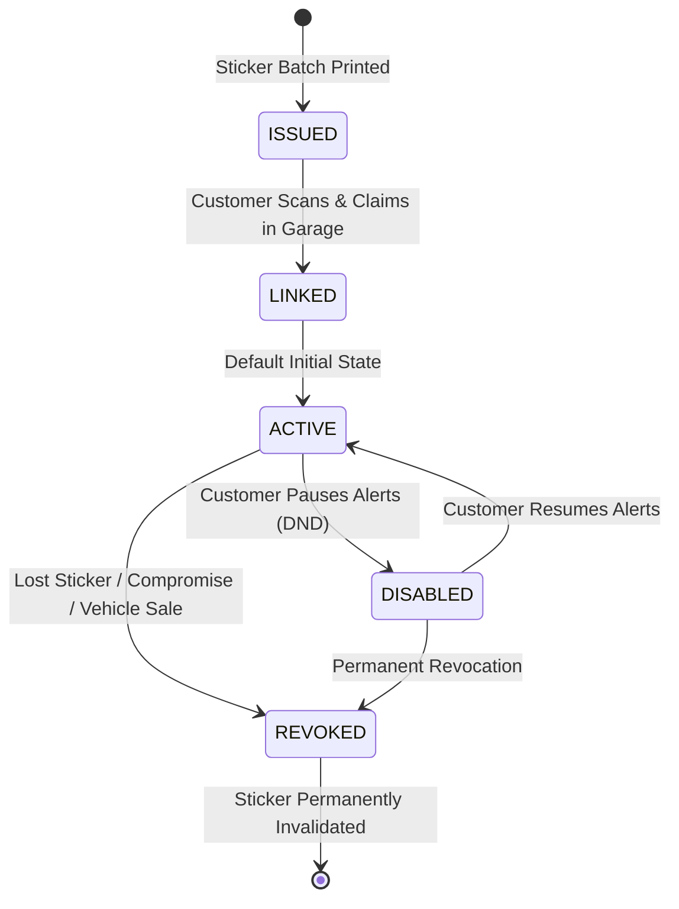

# V MOTIV Connect — QR Code & Sticker Lifecycle Management

## 1. QR Code Cryptographic Issuance
- **Raw Token Generation**:
  - `const rawToken = crypto.randomBytes(32).toString('hex');`
  - Yields 256 bits of cryptographic entropy (64 hex characters).
  - Unpredictable and resistant to enumeration or brute-force attacks.
- **Printed QR Target**:
  - Encoded URL: `https://<CONNECT_BASE_URL>/v/<rawToken>`
  - Printed on high-durability, UV-resistant vinyl adhesive stickers.
- **Storage Hash**:
  - Database stores: `tokenHash = sha256(rawToken)`
  - Public display preview: `vm_` + `rawToken.slice(0, 6)` (e.g., `vm_3a9f1b`).

---

## 2. State Machine & Transitions

### State Specifications:
1. **ISSUED**:
   - Physical sticker printed, ready for distribution or dispatch.
   - Pre-seeded in inventory with an optional cryptographic claim code.
2. **LINKED / ACTIVE**:
   - Sticker is associated with a single `CustomerVehicle` in V2.
   - Public scan returns vehicle make/model (without registration number or owner name).
   - Passerby can choose reason cards (`Vehicle Blocking Access`, `Lights Left On`, `Vehicle Needs Attention`, `Other Concern`) and send an alert.
3. **DISABLED (Paused / Do Not Disturb)**:
   - Owner temporarily disables incoming alerts.
   - Public scan displays a polite status: *"This vehicle's owner has paused incoming alerts. Please contact facility security or local parking management if urgent."*
   - Telephony bridge and messaging endpoints reject incoming transmissions.
4. **REVOKED**:
   - Permanent termination state. Cannot be reactivated.
   - Public scan renders security revocation notice: *"This QR code sticker has been revoked by the owner and is no longer active."*
   - Vehicle owner can order or link a replacement sticker immediately.

---

## 3. Physical Sticker Fulfillment Workflow
1. Customer navigates to **My Garage** -> **V MOTIV Connect™** -> **Order Physical Sticker**.
2. Enters delivery address, city, pincode, and special courier instructions.
3. V2 API records fulfillment order in `ConnectIntegrationAuditEvent` and issues tracking reference `REQ-STK-...`.
4. Partner courier dispatches sticker kit with application guide and alcohol wipe for windshield mounting.
5. Upon delivery, the customer scans the sticker inside the app to complete instant one-tap pairing.
